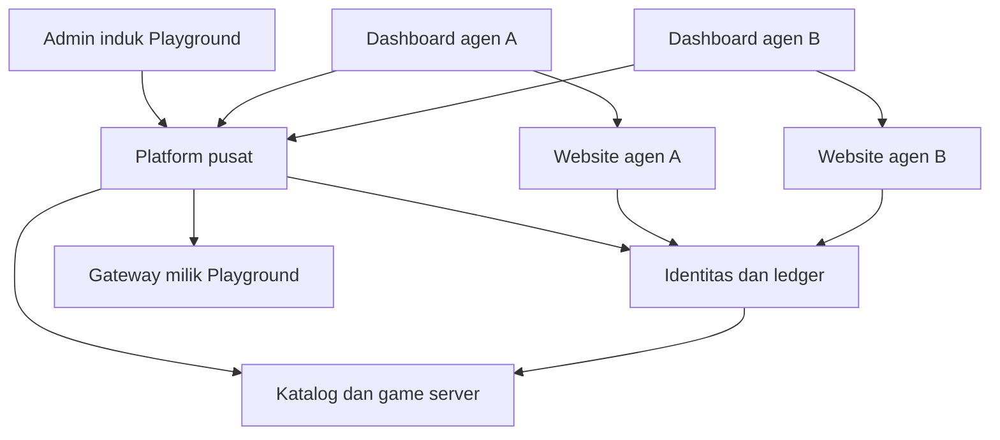

**Playground — Riset Workflow Bisnis, Audit Engine, dan Rencana Platform Agen**

Tanggal: 3 November 2026, WIB. Status: rancangan pra-implementasi.

Kesimpulan: Playground perlu menjadi platform pusat untuk katalog game, identitas, ledger, pembayaran, risiko, dan pengelolaan agen. Setiap agen memperoleh website berbrand sendiri dan dashboard yang dibatasi pada datanya. Fondasi GameOps sudah tersedia; platform agen dan transaksi uang belum tersedia end-to-end.

**1. Batas audit dan bukti terbaru**

- Repository utama yang dibaca: `9dbit/Playground`, main `9bbf6957f1296f9d417de293ee843d290bd147b8`, versi aplikasi `0.16.0`.
- Railway mengonfirmasi deployment `893318cf-f996-4cd7-b4ca-b8a4ab701791` berstatus SUCCESS pada commit yang sama. Saat diperiksa, admin, sandbox, dan Postgres online; tidak ada pending deployment.
- Audit membaca seluruh 17 modul `engine`, `server.js`, file UI terkait, adapter, tes terpilih, checkpoint CP09/12/14/15/16, dan draft audit CP17. Ada 33 deklarasi tabel dalam modul schema yang diperiksa; tidak ditemukan model tenant/agen atau asosiasi `tenant_id`/`agent_id` pada deklarasi tersebut.
- CP16 telah berada di main dan deployment; informasi percakapan lama bahwa CP16 masih lokal sudah kedaluwarsa. CP17 pada PR #17 masih draft audit, bukan implementasi produksi.
- Chatvice ditinjau terpisah pada main `1c0f9429b8517ce82a40b5a0e19899113c24e352`: schema, konfigurasi widget, endpoint embed, dan pemeriksaan domain. Audit ini tidak menguji integrasi Playground–Chatvice secara live.
- Validasi sesi ini adalah inspeksi source dan metadata deployment. Tidak ada perubahan engine, pengiriman pesan, pembukaan gateway, perubahan saldo, atau uji transaksi produksi. Hasil CI lama di checkpoint dibedakan dari tes yang dijalankan sekarang.

**2. Model bisnis yang disarankan**

Agen diperlakukan sebagai partner pemilik brand/website, disebut tenant. Affiliate yang hanya mendatangkan traffic menjadi jenis partner terpisah bila kelak dibutuhkan.

Mulai dengan satu agen–satu website, tetapi sediakan entitas site agar satu agen dapat mempunyai beberapa brand/domain di masa depan. Seluruh game masuk katalog induk Playground; agen memilih dari game yang telah diizinkan Playground untuk agen tersebut. Pilihan agen mengatur penayangan lobby, bukan konfigurasi hasil permainan.

| Lapisan | Tanggung jawab |
|---|---|
| Playground master | Agen, game registry, versi game, izin distribusi, ledger, gateway, kebijakan risiko, settlement, akses lintas agen yang diaudit |
| Website agen | Branding, halaman marketing, lobby, akun player, riwayat, antarmuka cashier melalui Playground, dukungan player |
| Dashboard agen | Operasional player sendiri, status transaksi, laporan, konten/SEO, staff, izin IP, tiket, panduan Chatvice |
| Game server | Hasil ronde berdasarkan versi aturan yang disetujui, komunikasi server ke Playground, bukti ronde dan pemulihan sesi |
| Chatvice | Panduan operasional dan dukungan; akses data mengikuti konteks dan izin pengguna |

Diagram menunjukkan tanggung jawab dan dependensi, bukan daftar service yang harus langsung dipisah deploy. Backend Express/PostgreSQL dapat dikembangkan sebagai aplikasi modular terlebih dahulu; pemisahan frontend master dan agen tidak mewajibkan rewrite seluruh engine.

Asumsi rancangan: identitas operasional dan saldo player terpisah per agen; satu saldo dipakai untuk semua game yang aktif di agen itu. Saldo antardua agen tidak otomatis berpindah. Penautan identitas lintas brand, jika diperlukan, ditangani pusat dengan kebijakan akses dan dasar penggunaan data yang jelas.

**3. Workflow bisnis dari pendaftaran sampai operasional**

| Tahap | Alur dan hasil |
|---|---|
| Onboarding agen | Playground membuat tenant, menetapkan kontak, perjanjian, model biaya, wilayah, batas fitur, status sandbox, dan pemilik agen |
| Provisioning | Sistem membuat workspace, website draft, konfigurasi domain, role awal, katalog yang diizinkan, dan konteks Chatvice |
| Konfigurasi website | Agen mengatur logo, warna, banner, halaman, SEO, canonical, daftar/urutan game, dan staff; preview terpisah dari publik |
| Verifikasi aktivasi | Domain/HTTPS, isolasi data, akses staff, game launch, ledger, support, dan kewajiban model bisnis diuji sebelum tenant aktif |
| Akuisisi dan akun player | Player datang ke domain agen; backend memetakan domain terverifikasi ke tenant; registrasi/login menghasilkan akun tenant tersebut |
| Deposit/top-up | Playground membuat payment intent, menangani konfirmasi provider, dan membukukan kredit hanya setelah bukti pembayaran terverifikasi |
| Bermain | Website meminta sesi game; Playground memeriksa player, tenant, entitlement dan versi; game memakai sesi berumur pendek |
| Withdraw | Saldo tersedia direservasi, pemeriksaan risiko dan approval dilakukan, lalu Playground mengirim payout dan mencocokkan status provider |
| Operasional harian | Agen memantau transaksi, sesi/ronde, tiket, masalah perangkat, dan performa gamenya; semua tindakan staff tercatat |
| Settlement agen | Playground membuat statement biaya/komisi sesuai kontrak, koreksi/refund/cadangan terlihat, lalu tutup periode yang dapat diaudit |
| Suspend/offboard | Hentikan aktivitas baru sesuai alasan; selesaikan ronde/transaksi yang masih berjalan, cabut sesi dan domain, sediakan ekspor/retensi sesuai kebijakan |

Suspend tidak boleh menghapus saldo atau membiarkan payout yang sudah dikirim menjadi ambigu. Kebijakan harus membedakan suspend login, suspend permainan baru, dan investigasi transaksi.

**4. Hasil audit: tersedia versus perlu dibangun**

| Area | Temuan source saat ini | Improvement |
|---|---|---|
| Katalog | Skygate 5000, UNO LUCK, Mahjong Wild di-seed; Game Edit/artwork dan metadata versioned tersedia | Registry dinamis, versi release, entitlement per agen, distribusi ke lobby |
| Integrasi game | Bridge HMAC, nonce, deduplikasi, heartbeat, dan penerimaan observasi ronde tersedia | Kontrak launch/auth/wallet yang seragam; bukti koneksi per kemampuan |
| Data ronde | CP15 memiliki observasi bertanda tangan, player pseudonim, filtering game/environment, dan rekonsiliasi source | Tambahkan tenant/site/session, cakupan identitas player, dan pelaporan lintas game dalam tenant |
| Wallet source | CP16 khusus UNO staging; UNO menulis saldo, Playground menyimpan jurnal/cerminan dan command terkonfirmasi | Migrasi authority ke ledger pusat untuk satu saldo lintas game |
| Wallet lama | Wallet virtual internal terpisah, DEMO_COIN, adjustment/transfer terkontrol | Pisahkan dari ledger baru; jangan menjumlahkan wallet lama dan saldo source sebagai dua aset |
| Admin security | Owner/operator/support/viewer global, MFA, CSRF, sesi, rate limit, audit | Tenant membership, izin per resource, staff agen, session audience master/agen |
| Risiko penggunaan operator | Role operator sekarang boleh PUT Game Edit global | Jangan gunakan operator lama sebagai role agen; endpoint agen harus menolak game rules dan data global |
| Tenant/agen | Belum ada model isolasi agen pada schema dan query yang diperiksa | Tenant/site/domain, pembatasan data pada seluruh jalur API dan background job |
| Akun player | Observasi pseudonim per game/environment; bukan akun login lintas game | PAM/akun player, pemetaan source account, verifikasi dan lifecycle akun |
| Pembayaran | Tidak ditemukan payment processor/cash ledger; request lama adalah metadata, bukan deposit/payout | Payment intents, callback, payout, refund, dispute, rekonsiliasi provider |
| IP/fingerprint player | Login history dan IP/user-agent yang tersedia adalah admin; belum ada pipeline device player | Sesi player, IP tepercaya, device signals, risk case, audit akses data |
| Whitelist IP staff | Belum ada kebijakan whitelist staff agen | CIDR IPv4/IPv6, aturan tenant/staff, pengecualian kedaluwarsa, pemulihan lockout |
| CMS/SEO | CRUD versioned, halaman info/policy publik, sitemap/robots, canonical dasar satu origin | Website agen, canonical/domain per tenant, metadata halaman, preview/publish/rollback |
| Settings | 19 kartu, sebagian hanya menyimpan nilai | Capabilities/status dari consumer aktual; jangan menganggap saved berarti aktif |
| Scheduler | Pembersihan sesi lokal sudah ada, tetapi beberapa label UI menyebut tidak ada scheduler | Perbaiki label; jangan disamakan dengan scheduler game/pembayaran |
| Script/extension | Extension belum mempunyai executor; CSP membatasi resource ke self; custom CSS hanya draft | Registry integrasi yang disetujui, batas penempatan, sandbox, versi dan rollback |
| Support | Ticket dan reply internal tersedia | Chatvice, antrean eskalasi, SLA, attachment, riwayat kasus terhubung player/round/transaksi |
| Chatvice | Widget ada di repository Chatvice; belum ada integrasinya dalam Playground | Wrapper resmi untuk master dan agen, knowledge operasional, konteks yang diverifikasi |

README masih menyatakan CP08 dan beberapa flag capability masih tertinggal. Contohnya, flag wallet global masih false meski pilot CP16 terbatas sudah ada. Ini bukan bukti seluruh wallet tidak tersedia; status harus dipisah antara wallet internal, UNO staging, wallet produksi, dan cash settlement.

**5. Status integrasi per game dan kontrak target**

| Game | Bukti yang tersedia dalam Playground | Pekerjaan tersisa |
|---|---|---|
| UNO LUCK | Pilot staging CP15/16: ronde, outbox, source journal, credit/debit terkonfirmasi. Source asli dan pilot terpisah | Identitas tenant, launch token, ledger pusat; migrasi source asli secara terencana |
| Mahjong Wild | Registry dan adapter heartbeat; audit CP09 mencatat Django/Postgres dan nominal Decimal | Audit ulang source terbaru, settlement adapter, round journal dan koneksi ledger pusat |
| Skygate 5000 | Registry dan heartbeat; audit CP09 belum menemukan settlement server authoritative | Audit ulang source terbaru; hasil/validasi ronde di server sebelum wallet bersama |

Temuan arsitektur game dari CP09 adalah catatan historis yang perlu divalidasi lagi saat implementasi; sesi ini tidak mengaudit seluruh source ketiga game atau membuktikan heartbeat live masing-masing.

Level readiness yang diusulkan: registered → connectivity verified → round evidence verified → launch verified → wallet verified → publishable. Status online tidak sama dengan siap dipakai player bertransaksi.

Kontrak game minimal mencakup game/version/environment, tenant/site/player/session, round ID, currency/unit, dan transaction ID. Server game mengautentikasi ke Playground dengan credential terpisah. Sesi launch singkat dan sekali tukar, terikat audience serta game; jangan menaruh credential jangka panjang di browser atau URL yang dicatat log.

Game baru yang ditambahkan ke katalog harus dapat memakai kontrak itu tanpa menambah slug hardcoded di beberapa modul. Kondisi tampil/launch adalah gabungan status aktif pusat, entitlement agen, pilihan agen, readiness, dan kesesuaian wilayah/unit. Pencabutan game pusat memblokir launch baru sambil memberi jalur penyelesaian ronde berjalan.

**6. Matriks hak akses target**

| Tindakan | Playground | Owner agen | Finance agen | Support agen | Marketing agen | Analyst agen |
|---|---|---|---|---|---|---|
| Daftar semua agen | Platform admin berizin | Tidak | Tidak | Tidak | Tidak | Tidak |
| Integrasi game/aturan/RTP | Game admin pusat | Tidak | Tidak | Tidak | Tidak | Tidak |
| Pilih dan urutkan game | Tetapkan izin | Ya, own tenant | Tidak | Baca | Ya jika diberikan | Baca |
| Gateway/API key/routing | Finance/integration pusat | Tidak | Tidak | Tidak | Tidak | Tidak |
| Riwayat deposit/withdraw | Sesuai tugas pusat | Own tenant | Own tenant | Status minimum | Tidak | Agregat |
| Kirim payout | Service pusat setelah policy/approval | Tidak langsung | Tidak langsung | Tidak | Tidak | Tidak |
| Review kasus withdraw | Sesuai policy | Bila didelegasikan | Bila didelegasikan | Catatan/eskalasi | Tidak | Tidak |
| Lihat saldo/ledger player | Sesuai tugas | Own tenant | Own tenant | Sesuai kebutuhan | Tidak | Agregat |
| Koreksi saldo | Workflow pusat dengan alasan/approval | Ajukan permintaan | Ajukan permintaan | Eskalasi | Tidak | Tidak |
| IP/fingerprint player | Risk/support berizin | Izin khusus | Izin khusus | Izin khusus | Tidak | Agregat tersamarkan |
| SEO/canonical/banner | Platform oversight | Own tenant | Tidak | Tidak | Own tenant | Baca bila perlu |
| Staff/role/IP whitelist | Platform admin | Own tenant | Tidak | Tidak | Tidak | Tidak |
| Custom integration | Setujui registry/policy | Konfigurasi yang diizinkan | Tidak | Tidak | Konfigurasi yang diizinkan | Tidak |
| Audit/ekspor | Sesuai scope | Own tenant | Finance sendiri | Kasus sendiri | Konten sendiri | Dataset yang diizinkan |
| Chatvice panduan | Sesuai role pusat | Sesuai role | Sesuai role | Sesuai role | Sesuai role | Sesuai role |

Role Playground sendiri juga perlu dipecah menjadi platform owner, game operations, finance, risk, dan support. Hak lintas agen hanya untuk pekerjaan yang memerlukannya. Tenant owner tidak boleh memberikan hak melebihi batas kontrak/izin platform.

Implementasi otorisasi harus memeriksa tindakan dan kepemilikan resource di server untuk setiap request. Menu yang disembunyikan hanya membantu UI. Desain ini mengikuti prinsip least privilege dan deny-by-default dari [OWASP Authorization](https://cheatsheetseries.owasp.org/cheatsheets/Authorization_Cheat_Sheet.html).

**7. Pemisahan data dan perubahan schema**

Tambahkan kelompok entitas berikut; nama masih rancangan, bukan migration yang telah dibuat.

| Kelompok | Entitas usulan |
|---|---|
| Organisasi | tenants, sites, verified_domains, staff_memberships, roles, permission_grants |
| Distribusi game | games, game_releases, tenant_game_entitlements, site_game_placements, game_sessions |
| Player | tenant_players, player_auth_identities, game_player_links, player_sessions, player_device_events |
| Ledger | wallet_accounts, journal_transactions, journal_entries, fund_reservations, reconciliation_runs |
| Pembayaran | payment_intents, provider_events, payouts, refunds, disputes, payment_reconciliation |
| Marketing | tenant_content, content_revisions, media_assets, seo_settings, redirects, integration_installations |
| Operasional | risk_cases, approval_requests, audit_events, support_links, notification_jobs |
| Komersial | agent_contract_versions, settlement_periods, agent_statements, commission_entries |

Verified domain dipakai untuk memilih website publik; domain/header tidak menjadi bukti hak admin. Konteks tenant harus berasal dari sesi dan membership yang diverifikasi. Batas yang sama berlaku untuk ekspor, pencarian, cache, media, queue, chat, dan pemulihan data. Ini selaras dengan [OWASP Multi Tenant Security](https://cheatsheetseries.owasp.org/cheatsheets/Multi_Tenant_Security_Cheat_Sheet.html).

Untuk PostgreSQL, gunakan query yang selalu membawa scope dan RLS sebagai lapisan tambahan. Role request aplikasi tidak boleh superuser/BYPASSRLS; kebijakan owner tabel juga perlu diperhatikan. Jalur admin pusat dibuat eksplisit. [Dokumentasi PostgreSQL](https://www.postgresql.org/docs/current/ddl-rowsecurity.html) menjelaskan bahwa owner/superuser dapat melewati row security.

Migrasi data lama tidak boleh menebak kepemilikan agen. Tempatkan catatan lama dalam scope legacy/platform yang hanya diakses pusat sampai ada bukti pemetaan. Tambahkan kolom dan indeks, lakukan backfill terverifikasi, lalu perketat constraint. Pisahkan deployment staging dan produksi; audit connection pooling supaya konteks tenant tidak tertinggal.

**8. Satu saldo lintas game: keputusan arsitektur utama**

Rekomendasi: ledger Playground menjadi sumber saldo untuk game yang sudah dimigrasi. Game menentukan hasil sesuai aturan; ledger memutuskan apakah dana dapat dipakai dan membukukan transaksi. Tampilan saldo di game adalah pembacaan/cerminan, bukan penulis saldo kedua.

Saldo perlu memisahkan available, reserved, bonus yang mempunyai batas penggunaan, dan dana withdraw pending. Rekening player, kas/clearing provider, pendapatan/biaya, kewajiban agen, dan reserve dipisah dalam pencatatan double-entry. Journal final tidak diedit; koreksi menghasilkan entry pembalik/penyesuaian beralasan.

Untuk tiap ronde: validasi sesi → reserve/debit sesuai kontrak → hasil server → posting payout → tutup ronde. Retry menggunakan ID bisnis yang sama. Ronde putus jaringan masuk recovery; refund/rollback hanya untuk kondisi yang terbukti, bukan timeout semata. Ronde aktif dua game tidak boleh menghabiskan saldo yang sama.

Migrasi CP16: tentukan cutover per player/game; hentikan pembuatan ronde baru sementara, tuntaskan ronde aktif, cocokkan jurnal, ambil opening balance terverifikasi, pindahkan authority satu kali, lalu jalankan jalur baru. Dual-write saldo harus dihindari. Saldo DEMO_COIN lama tidak otomatis menjadi uang/redeemable dan tidak otomatis ditambahkan ke saldo baru.

Checkpoint CP16 memuat trigger SQLite yang bergantung fungsi aplikasi. Rollback image pilot lama tanpa maintenance migration dapat merusak penulisan. Gunakan feature gate untuk pause sambil mempertahankan kompatibilitas database; jangan reset volume.

**9. Pembayaran terpusat dan settlement agen**

Keputusan tetap sesuai permintaan: agen tidak memilih gateway, tidak melihat credential, dan tidak mengubah routing atau tujuan webhook. Agen melihat metode yang sudah ditetapkan Playground dan status transaksi miliknya.

| Alur | State target dan aturan |
|---|---|
| Deposit | created → pending → confirmed/failed/expired; kredit sekali setelah verifikasi backend terhadap provider |
| Withdraw | requested → funds_reserved → review → approved → submitted → paid; failed/rejected/cancelled mempunyai aturan pelepasan reserve |
| Payout ambigu | submitted/unknown tetap ditahan untuk rekonsiliasi; jangan otomatis mengirim payout kedua |
| Refund/dispute | Catat kaitan ke transaksi asal, bukti dan dampak saldo; gunakan posting koreksi, bukan menghapus riwayat |
| Rekonsiliasi | Cocokkan order/provider event, ledger, settlement provider, dan rekening penerimaan sesuai jadwal |

Payment callback harus diautentikasi, amount/currency/order dicocokkan, dan kredit idempotent. Halaman redirect sukses tidak membuktikan pembayaran. Notifikasi terlambat atau tidak berurutan perlu diperiksa terhadap status provider. Rujukan: [OWASP Payment Gateway Integration](https://cheatsheetseries.owasp.org/cheatsheets/Third_Party_Payment_Gateway_Integration_Cheat_Sheet.html).

Review agen, bila diizinkan, adalah tahap operasional; otorisasi pengiriman uang tetap berdasarkan policy Playground. Koreksi dan payout besar memakai pemisahan pengaju–penyetuju dan jejak audit. Nominal threshold belum ditentukan.

Usulan model komersial awal: biaya setup, biaya platform bulanan, dan biaya penggunaan yang terukur. Revenue share bisa menjadi opsi kontrak setelah definisi GGR/NGR, bonus, pajak, refund, chargeback, biaya provider, minimum fee, reserve, negative carryover, serta jadwal settlement disepakati. Jangan menghitung komisi dari gross deposit tanpa definisi bisnis.

Gateway terpusat tidak otomatis menjadikan Playground merchant of record. Model legal penerimaan dana, pemilik kewajiban player, dan kemungkinan submerchant perlu ditetapkan dengan provider. Untuk model redeemable/uang nyata, wilayah operasi, lisensi, verifikasi usia/KYC/AML dan persetujuan provider merupakan dependensi aktivasi. Contohnya, [Xendit menyatakan tidak melayani online gambling](https://help.xendit.co/hc/en-us/articles/360035083951-Are-there-any-businesses-that-Xendit-prohibits). Karena itu pilihan gateway belum dapat diasumsikan hanya dari kemampuan API; tidak ada provider yang direkomendasikan/diaktifkan dalam riset ini.

**10. Fitur agen tambahan hasil riset**

Benchmark produk memperlihatkan kelompok kebutuhan yang relevan: player management, pengaturan lobby, transaksi, anti-fraud, laporan, dukungan, dan pengelolaan konten. [SOFTSWISS](https://www.softswiss.com/casino-platform/) menyajikan kategori tersebut. Rekomendasi di bawah adalah rancangan untuk Playground, bukan klaim seluruh fitur vendor harus disalin.

| Modul agen | Fungsi yang berguna |
|---|---|
| Overview | Player aktif, ronde, stake/payout, status top-up/withdraw, kasus tertunda, insiden game, waktu data terakhir |
| Players | Profil, status verifikasi aktual, catatan internal, sesi, history ronde, transaksi dan tiket dalam satu timeline |
| Finance | Pencarian transaksi, alasan status gagal/pending, rekonsiliasi, statement, ekspor terkontrol, audit koreksi |
| Risk & disputes | Kasus multi-account/device, pola transaksi anomali, pemeriksaan manual, bukti ronde, keputusan dan banding |
| Staff | Invitation, role, MFA, whitelist IP, revoke session, akses kedaluwarsa dan audit aktivitas |
| Website | Banner, kategori/game pilihan, SEO, halaman kebijakan, preview, jadwal publish, rollback, status domain/HTTPS |
| Support | Chatvice, antrean tiket, SLA, escalation ke Playground, template jawaban dan status insiden |
| Laporan | Hasil per game/player/periode; filter waktu dan unit; ekspor; penanda incomplete/stale/reconciled |
| Commercial | Paket agen, invoice, penggunaan, statement komisi/biaya, transaksi settlement |
| Notifikasi | Callback gagal, withdraw lama, source mismatch, sesi staff baru, error game dan domain menjelang expiry |
| Player protection | Batas waktu/pengeluaran, cooling-off, self-exclusion dan penanganan keluhan sesuai model/market |
| Promosi opsional | Referral/affiliate, kampanye dan bonus berbudget yang dijalankan lewat ledger serta aturan yang jelas |

Kemenangan player dianalisis dengan membedakan hit rate, net winning rounds, payout/stake (observed RTP), net player result, dan jumlah sample. GGR dasar adalah stake dikurangi payout, dengan aturan void/bonus/currency yang eksplisit. GGR tidak sama dengan kas atau laba bersih. Pembacaan RTP player dengan sample kecil tidak cukup untuk membuktikan fraud.

Akses agen terhadap pengaturan chance/RTP ditolak. Di pusat, pengaturan aturan/payout sebaiknya berbentuk versi release, review, pemberitahuan dan rollout yang terkontrol. Jangan menghubungkan laporan menang/kalah player dengan perubahan peluang individual. Sebagai benchmark fairness khusus pasar Britania Raya, [UK Gambling Commission RTS 7](https://www.gamblingcommission.gov.uk/manual/remote-gambling-and-software-technical-standards/rts-7-generation-of-random-outcomes) melarang adaptive compensation dan membatasi perubahan probabilitas saat game tersedia untuk dimainkan. Rujukan ini bukan penetapan yurisdiksi Playground.

IP/fingerprint adalah sinyal risiko, bukan identitas pasti. Dokumentasi [Fingerprint](https://docs.fingerprint.com/docs/identification-accuracy-and-confidence) menjelaskan kemungkinan false positive/negative. Panel perlu menampilkan waktu, confidence/source, perangkat dan keterkaitan yang relevan; keputusan negatif memerlukan pemeriksaan. Jangan membocorkan nama/detail player agen lain melalui indikator cross-tenant. Pusat dapat mengirim sinyal risiko terbatas, dengan akses dan retensi data yang dicatat.

**11. SEO, canonical, dan custom script**

SEO per site meliputi title, description, Open Graph, slug, canonical, robots, sitemap, redirect, konten halaman, dan validasi preview. Canonical default mengarah ke URL utama pada domain agen itu sendiri; jangan otomatis mengarahkan seluruh agen ke domain Playground. Alias domain diarahkan ke domain utama. [Google Search Central](https://developers.google.com/search/docs/crawling-indexing/consolidate-duplicate-urls) menjelaskan canonical sebagai sinyal konsolidasi URL duplikat; canonical tidak menjamin ranking.

Domain baru harus diverifikasi sebelum publikasi. Canonical lintas domain perlu validasi tujuan dan persetujuan platform. Dashboard, akun, cashier dan data privat tetap dilindungi autentikasi; robots/noindex bukan kontrol keamanan.

Agen memperoleh menu Integrations untuk konfigurasi widget/analytics yang disetujui. Integrasi mempunyai vendor, origin, versi, halaman tujuan, tujuan pengumpulan data, status, dan kill switch. Script bebas di dashboard atau cashier berisiko membaca data pada halaman itu; gunakan integrasi terkelola atau iframe lintas origin yang dibatasi. Kontrol ini mengikuti pembahasan [OWASP Third Party JavaScript](https://cheatsheetseries.owasp.org/cheatsheets/Third_Party_Javascript_Management_Cheat_Sheet.html). Pengecualian script yang memerlukan DOM perlu review tersendiri.

**12. Rencana Chatvice untuk panduan operasional**

| Lokasi | Knowledge dan akses |
|---|---|
| Playground master | SOP onboarding agen, kesehatan game, rekonsiliasi, status integrasi, incident runbook; informasi sesuai role pusat |
| Dashboard agen | Cara mengatur website/SEO/staff, membaca transaksi/ronde, menyelesaikan tiket; data hanya tenant aktif |
| Website player, tahap tambahan | FAQ brand, aturan, bantuan akun dan status transaksi milik player; terpisah dari panduan internal |

Source Chatvice sudah memiliki `/api/widget/chatvice.js?merchant=...`, embed iframe, merchant-scoped knowledge/session, dan pemeriksaan domain. UI juga mempunyai contoh identity token dan schema secret; sesi ini belum membuktikan verifikasi token sampai seluruh endpoint chat. Ini menjadi acceptance gate, bukan dianggap SSO yang selesai.

Ada dua hambatan konkret: CSP Playground saat ini hanya mengizinkan resource self, sedangkan Chatvice eksternal; dan Chatvice mempunyai grace mode ketika belum ada domain tervalidasi. Konfigurasi production perlu domain valid dan jalur penolakan yang terbukti. Wrapper resmi harus diuji terhadap CSP dan kebijakan referrer, bukan membuka wildcard seluruh dashboard.

Tahap awal Chatvice menjawab knowledge SOP yang telah disetujui. Untuk jawaban yang membutuhkan transaksi, tambahkan backend context/lookup dengan identitas staff, tenant, role dan TTL terverifikasi; chatbot tidak diberi credential admin. Knowledge, session, retrieval dan handoff harus terisolasi. Ganti tenant atau logout mengakhiri/mengganti sesi chat. Jika Chatvice gagal, dashboard tetap berfungsi dan menyediakan link bantuan/tiket.

Konten awal panduan: onboarding agen; memilih game; SEO/canonical; mengundang staff dan whitelist; membaca status deposit/withdraw; saldo available/reserved; rekonsiliasi; dispute ronde; insiden game; dan eskalasi Playground. Jawaban menunjuk SOP versi yang berlaku dan membedakan fakta transaksi terverifikasi dari panduan umum.

**13. Urutan implementasi yang direkomendasikan**

| Tahap | Scope | Kriteria selesai |
|---|---|---|
| A — Rapikan baseline | CP17 runtime capabilities, label status, source of truth laporan, migration inventory | UI membedakan stored/active/pilot/unavailable; tidak ada klaim koneksi yang keliru |
| B — Fondasi agen | Tenant/site/domain, staff membership, permission, tenant audit, isolasi API/database | Dua tenant sintetis lulus test silang pada list/detail/search/export/media/job; master tetap berfungsi |
| C — Akun dan katalog | Player auth, game mapping, entitlement, lobby, launch service | Player dapat login di agen, hanya meluncurkan game yang diizinkan; revocation efektif |
| D — Ledger dan game | Ledger pusat, satu saldo tenant, reserve/settle/recovery, migrasi pilot UNO, adapter game lain | Replay tidak menggandakan saldo; ronde paralel aman; rekonsiliasi source/ledger cocok |
| E — Website dan support | Template website agen, CMS/banner, SEO/canonical, Chatvice master/agen | Publish terverifikasi, rollback konten, domain isolation, widget dan SOP berfungsi sesuai role |
| F — Cashier dan risk | Gateway pusat sandbox, deposit/payout/refund/dispute, identity/risk/protection, whitelist produksi | Semua state gagal/unknown/retry teruji; provider dan model bisnis disetujui sebelum uang nyata |
| G — Komersial dan rollout | Statement/fee/commission, monitoring, restore drill, UAT operasional | Pilot dua agen dapat menjalankan alur lengkap; recovery dan akses lintas tenant terverifikasi |

Tahap E dapat dikerjakan setelah fondasi B sambil C/D berkembang. F baru memakai uang nyata setelah dependensi bisnis/provider selesai. Mulai integrasi penuh pada UNO pilot karena bukti source/journal sudah paling maju, kemudian Mahjong dan Skygate setelah audit source masing-masing. Semua game baru masuk website aktif setelah lolos gate, bukan hanya karena telah masuk registry.

**14. Acceptance tests yang wajib direncanakan**

1. Agen A tidak dapat membaca/mengubah data B dengan mengganti ID, domain, query, token, halaman ekspor atau sesi chat.
2. Agen tidak bisa membuka daftar agen, game rules, gateway config, secret atau API pusat meskipun endpoint diketahui.
3. Membership/role/IP restriction yang dicabut langsung membatasi sesi dan request berikutnya; tersedia pemulihan lockout yang diaudit.
4. Duplicate callback atau retry ronde menghasilkan satu posting; callback palsu, amount/currency salah dan replay ditolak.
5. Dua ronde bersamaan dan satu withdraw tidak bisa memakai dana yang sama; saldo tersedia tidak negatif.
6. Payout timeout tidak dianggap gagal final lalu dibayar ulang; lookup/reconciliation mengakhiri status unknown.
7. Game/site suspend menolak sesi baru, menyelesaikan ronde berjalan sesuai aturan, dan tidak menghilangkan ledger.
8. Unit/precision Mahjong dipertahankan; demo/production, tenant dan currency tidak bercampur dalam total.
9. Canonical/sitemap, konten dan cache mengikuti domain tenant; preview tidak bocor sebagai halaman publik.
10. Chatvice menolak konteks palsu, perubahan tenant dan akses knowledge/data lintas tenant; kegagalan widget tidak mematikan dashboard.
11. Restore dan pemulihan outbox membuktikan tidak ada saldo ganda/ronde hilang; audit tetap terhubung actor dan alasan.
12. Regresi CP14–CP16 berjalan pada lingkungan tes; UAT browser memakai server/database nyata untuk fitur yang diklaim end-to-end.

**15. Keputusan bisnis yang belum dikunci**

| Keputusan | Asumsi rancangan sementara | Kapan diperlukan |
|---|---|---|
| Makna koin | DEMO_COIN existing tetap nonredeemable; model uang nyata dibuat terpisah | Sebelum desain final cashier dan konversi |
| Pasar/wilayah | Belum ditentukan; tidak mengasumsikan izin dari lokasi hosting/domain | Sebelum pemilihan provider dan launch uang nyata |
| Hubungan komersial | Agen adalah tenant pemilik brand; affiliate terpisah | Sebelum kontrak/commission |
| Identitas/saldo lintas agen | Terpisah per agen; shared across games dalam tenant | Sebelum migration player |
| Penerima dana dan kewajiban | Gateway dioperasikan pusat; merchant of record/submerchant belum ditetapkan | Sebelum onboarding provider |
| Approval withdraw | Agen dapat review bila diberi izin; eksekusi pusat | Sebelum UAT keuangan |
| Harga/settlement | Setup + bulanan + usage sebagai usulan; belum ada nominal/periodisasi final | Sebelum invoice dan statement |
| Domain/brand pilot | Dua agen sintetis dahulu; nama/domain asli belum ditetapkan | Sebelum website publik |

Pekerjaan konkret berikutnya adalah A dan B: jadikan capability aktual transparan, lalu bangun isolasi tenant dan akses agen. Ini memungkinkan website, game selection, laporan dan Chatvice berkembang di atas batas data yang benar.

**Lampiran bukti source**

| Bukti | Lokasi yang dibaca |
|---|---|
| Versi, schema dasar, tiga game, CSP | [server.js](https://github.com/9dbit/Playground/blob/9bbf6957f1296f9d417de293ee843d290bd147b8/server.js#L20) |
| Role dan sesi global | [security.js](https://github.com/9dbit/Playground/blob/9bbf6957f1296f9d417de293ee843d290bd147b8/engine/security.js#L19) |
| Operator boleh edit game; settings owner | [security-policy.js](https://github.com/9dbit/Playground/blob/9bbf6957f1296f9d417de293ee843d290bd147b8/engine/security-policy.js#L25) |
| Game profile dan metadata persentase | [deep-routes.js](https://github.com/9dbit/Playground/blob/9bbf6957f1296f9d417de293ee843d290bd147b8/engine/deep-routes.js#L17) |
| Protocol dan hardcoded game scope | [game-bridge.js](https://github.com/9dbit/Playground/blob/9bbf6957f1296f9d417de293ee843d290bd147b8/engine/game-bridge.js#L10) |
| Laporan terbatas game/environment | [game-data.js](https://github.com/9dbit/Playground/blob/9bbf6957f1296f9d417de293ee843d290bd147b8/engine/game-data.js#L7) |
| Pemetaan observed players | [stream-reconciliation.js](https://github.com/9dbit/Playground/blob/9bbf6957f1296f9d417de293ee843d290bd147b8/engine/stream-reconciliation.js#L13) |
| Wallet staging UNO dan owner review | [source-wallet.js](https://github.com/9dbit/Playground/blob/9bbf6957f1296f9d417de293ee843d290bd147b8/engine/source-wallet.js#L1) |
| Wallet virtual lokal | [virtual-wallet.js](https://github.com/9dbit/Playground/blob/9bbf6957f1296f9d417de293ee843d290bd147b8/engine/virtual-wallet.js#L7) |
| Canonical dan sitemap satu origin | [public-content.js](https://github.com/9dbit/Playground/blob/9bbf6957f1296f9d417de293ee843d290bd147b8/engine/public-content.js#L7) |
| Schema settings | [settings-schema.js](https://github.com/9dbit/Playground/blob/9bbf6957f1296f9d417de293ee843d290bd147b8/engine/settings-schema.js#L19) |
| Status parity yang tertinggal | [parity.js](https://github.com/9dbit/Playground/blob/9bbf6957f1296f9d417de293ee843d290bd147b8/engine/parity.js#L111) |
| Checkpoint wallet terdeploy | [CP16](https://github.com/9dbit/Playground/blob/9bbf6957f1296f9d417de293ee843d290bd147b8/sources/PLAYGROUND_CHECKPOINT_16_WALLET.md) |
| CP17 masih audit | [Draft PR #17](https://github.com/9dbit/Playground/pull/17) |
| Chatvice embed dan domain validation | [routes.ts](https://github.com/9dbit/Chatvice/blob/1c0f9429b8517ce82a40b5a0e19899113c24e352/server/routes.ts#L18040) |
| Chatvice domain grace mode | [routes.ts](https://github.com/9dbit/Chatvice/blob/1c0f9429b8517ce82a40b5a0e19899113c24e352/server/routes.ts#L6504) |
| Chatvice embed/identity examples | [widget.tsx](https://github.com/9dbit/Chatvice/blob/1c0f9429b8517ce82a40b5a0e19899113c24e352/client/src/pages/dashboard/widget.tsx#L923) |

Rujukan publik diakses 3 November 2026. Informasi vendor dipakai sebagai benchmark fitur, bukan bukti performa Playground atau rekomendasi pembelian. Roadmap di dokumen ini adalah usulan; tidak ada klaim modul agen, payment, atau widget sudah dipasang.

## Pembaruan implementasi — 8 November 2026

UNO, Mahjong dan Skygate telah menggunakan wallet pusat pada sandbox melalui runtime native. Publikasi konfigurasi Studio Mahjong/Skygate kini tersedia dari master **Manage Games → Rilis Studio**: simpan paket, validasi oleh game, penerbitan eksplisit dengan verifikasi master, konfirmasi penerapan dan rollback. Akun agen tetap hanya dapat memilih game yang diberi entitlement. Lihat [bukti implementasi dan batas pengujian](NATIVE_STUDIO_PUBLICATION_2026-11-08.md). Matriks awal di atas adalah snapshot riset 3 November, bukan status deploy terbaru.
