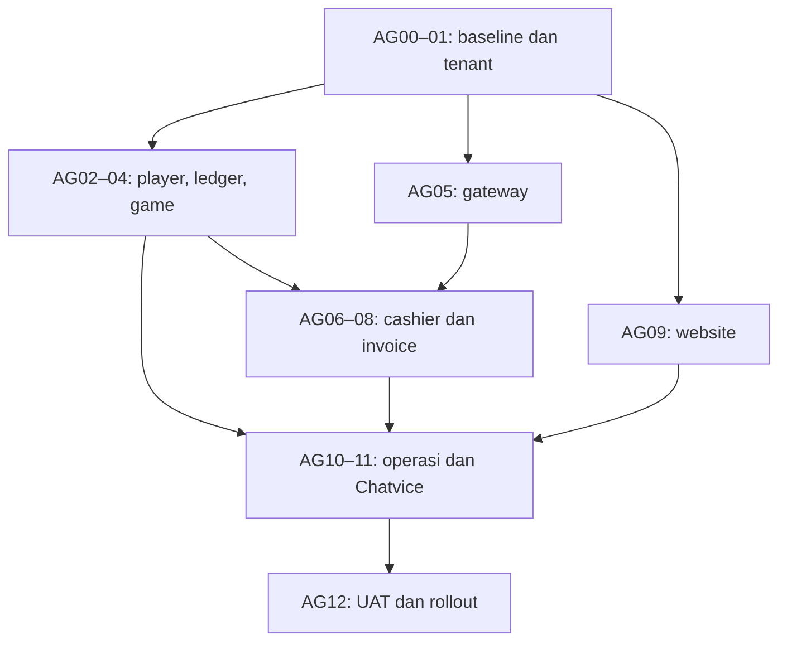

**Playground — Rencana Kerja Platform Agen, Integrasi Game, dan Money Flow**

Tanggal: 3 November 2026, WIB. Versi plan: 1.0. Status: rencana implementasi berdasarkan riset dan persetujuan arah desain; seluruh checkpoint baru berstatus belum dikerjakan.

Tujuan: menjadikan Playground induk seluruh game, website agen, identitas player, ledger, koneksi pembayaran, operasional, dan billing. Setiap agen mempunyai website dan dashboard sendiri; approval deposit/withdraw menjadi wewenang agen, sedangkan Playground menjalankan integrasi dan pencatatan pusat.

**Dokumen dasar dan aturan penggabungan**

Rencana ini memasukkan cakupan dari kedua dokumen berikut, bukan hanya fitur pembayaran:

- [PLAYGROUND_AGENT_WORKFLOW_RESEARCH_2026-11-03.md](PLAYGROUND_AGENT_WORKFLOW_RESEARCH_2026-11-03.md): audit engine, platform agen, katalog dan adapter game, akses, website/SEO, data player, serta Chatvice.
- [PLAYGROUND_MONEY_FLOW_RESEARCH_V2_2026-11-03.md](PLAYGROUND_MONEY_FLOW_RESEARCH_V2_2026-11-03.md): authority agen, deposit/withdraw, stok koin, account gateway, invoice 20%, dan koreksi antarbulan.

Jika kedua riset berbeda, arahan money flow terbaru dan keputusan pengguna berlaku. Rekomendasi desain yang telah disetujui menjadi dasar plan; nominal, provider, domain, dan ketentuan kontrak yang belum diberikan tetap menjadi input konfigurasi, bukan diisi dengan data rekaan.

| Hal yang diselaraskan | Ketentuan dalam plan ini |
|---|---|
| Approval transaksi | Agen mengatur dan menyetujui deposit/withdraw; Playground memverifikasi, mengeksekusi instruksi sah dan merekonsiliasi |
| Pilihan gateway | Tetap milik Playground; agen tidak memilih provider atau mengubah credential/webhook/routing |
| Harga platform | Default fee 20% dengan dua pilihan basis; usulan lama setup fee + biaya bulanan + usage tidak otomatis diterapkan |
| Koin agen | Alokasi stok jual postpaid/konsinyasi dengan limit; stok belum terjual tidak ditagih |
| Saldo player | Satu saldo per agen untuk seluruh game yang terintegrasi; saldo antaragen terpisah |
| Withdraw threshold | Contoh awal: kurang dari Rp1 juta kandidat otomatis, Rp1 juta atau lebih manual; nominal dapat diubah oleh role agen yang berwenang |
| Invoice net negatif | Perhitungan ulang kumulatif/credit note menjadi rancangan awal; ketentuan pembayaran kredit dan penutupan kontrak harus eksplisit |
| Chatvice | Widget di master Playground, dashboard agen, serta konfigurasi widget dukungan pada website agen; konteks internal dan publik dipisah |

**Baseline yang digunakan, bukan klaim audit ulang**

Riset terdahulu memeriksa Playground main `9bbf6957f1296f9d417de293ee843d290bd147b8`, v0.16.0/CP16, serta deployment Railway yang sesuai. CP17 masih berupa draft audit saat pemeriksaan itu. Chatvice yang diperiksa berada pada commit `1c0f9429b8517ce82a40b5a0e19899113c24e352`. Penyusunan plan ini membaca kedua laporan, tidak mengaudit ulang branch/deployment terbaru.

| Fondasi yang tercatat | Perlakuan implementasi |
|---|---|
| Registry tiga game, bridge bertanda tangan, observasi ronde | Dikembangkan menjadi registry dinamis, kontrak integrasi dan kesiapan per game |
| Role global dan audit admin | Dipertahankan untuk pusat, diperluas dengan membership/permission agen; role operator lama tidak dijadikan role agen |
| UNO pilot CP16, source menulis saldo | Dimigrasi bertahap ke ledger pusat, dengan satu pihak penulis saldo pada satu waktu |
| Wallet virtual lama dan demo | Tetap terpisah; tidak dikonversi menjadi saldo redeemable secara otomatis |
| CMS, SEO dasar, tiket internal | Dipakai ulang setelah diberi scope tenant dan consumer yang nyata |
| Belum ada platform agen/cashier end-to-end | Dibangun sebagai modul baru, tidak ditandai selesai karena menu atau setting sudah ada |

Nomor pekerjaan menggunakan **AG00–AG13** agar tidak bertabrakan dengan CP17 atau checkpoint engine yang mungkin sudah berkembang. AG00 memeriksa baseline aktual sebelum perubahan kode. Plan ini tidak membuat commit, mengubah konfigurasi, atau menjalankan transaksi.

**Hasil akhir rilis pertama**

- Playground master dapat membuat agen, memberi hak game, memproses alokasi koin, mengatur koneksi gateway dan kontrak, serta melihat rekonsiliasi/invoice sesuai izin.
- Agen dapat mengelola staff, website, game pilihan, player miliknya, transaksi, aturan withdraw, laporan, SEO/canonical, integrasi yang diizinkan, dan bantuan Chatvice.
- Player dapat mendaftar di website agen, deposit, menggunakan satu wallet pada game yang lolos verifikasi, withdraw, serta melihat status dan riwayat yang akurat.
- Seluruh game masuk registry pusat. UNO menjadi pilot integrasi penuh; Mahjong Wild dan Skygate 5000 mengikuti adapter dan pemeriksaan masing-masing sebelum ditampilkan sebagai dapat dimainkan.
- Alur uang, stok koin, saldo player dan fee dapat direkonsiliasi, termasuk transaksi gagal, terlambat, duplikat dan koreksi antarbulan.

**Urutan checkpoint dan dependensi**

P0 berarti fondasi atau kontrol transaksi yang memblokir aktivasi. P1 adalah fitur operasional yang juga wajib selesai untuk rilis pertama. P2 merupakan pengembangan setelah rilis; bukan pengganti kebutuhan awal pengguna.

| ID | Prioritas | Pekerjaan | Dependensi utama | Bukti selesai |
|---|---|---|---|---|
| AG00 | P0 | Baseline, kontrak data dan daftar keputusan | Kedua riset | Matriks aktual, kontrak transaksi, keputusan/input tercatat |
| AG01 | P0 | Tenant, akses master/agen, staff dan IP | AG00 | Dua agen terisolasi pada API, database, job dan sesi |
| AG02 | P0 | Player, katalog, entitlement dan launch | AG01 | Login tenant dan launch hanya game yang diizinkan |
| AG03 | P0 | Ledger pusat dan stok koin | AG01, kontrak AG00 | Saldo/reserve/stok konsisten dalam transaksi bersamaan |
| AG04 | P0 | Integrasi penuh ketiga game | AG02, AG03 | Ronde, saldo, recovery dan pencabutan game terverifikasi |
| AG05 | P0 | Gateway dan mapping shared/split | AG01, kontrak AG00 | Mapping per agen dan adapter sandbox dapat direkonsiliasi |
| AG06 | P0 | Deposit otomatis/manual | AG02, AG03, AG05 | Satu pembayaran menghasilkan satu kredit dan satu penjualan |
| AG07 | P0 | Withdraw, supervisor dan payout | AG02, AG03, AG05 | Approval, reserve dan payout aman dari duplikasi |
| AG08 | P0 | Rekonsiliasi dan invoice 20% | AG03, AG06, AG07 | Dua basis, credit note dan closing lintas bulan cocok |
| AG09 | P1 | Website agen, CMS, SEO dan integrasi | AG01, AG02 | Domain, lobby, konten dan canonical benar per site |
| AG10 | P1 | Dashboard agen/master, analitik dan operasi | AG02–AG08 | Semua menu memakai data dan action sesuai permission |
| AG11 | P1 | Chatvice dan panduan operasional | AG01, AG09, AG10 | Konteks master/agen/player terpisah, handoff berfungsi |
| AG12 | P0 | UAT, migrasi, pilot, deploy dan observasi | AG01–AG11 | Seluruh pemeriksaan rilis lulus dan recovery terbukti |
| AG13 | P2 | Pengembangan lanjutan | AG12 | Scope tambahan dinilai terpisah setelah operasi stabil |

Website/CMS dapat mulai setelah fondasi tenant tersedia. Adapter gateway, ledger dan template website dapat dikembangkan melalui kontrak yang sama; penyelesaian checkpoint tetap mengikuti dependensi tabel. Penyusunan knowledge Chatvice dapat berjalan lebih awal, tetapi integrasi belum dianggap selesai sebelum batas akses dan halaman target tersedia.

Diagram merangkum kelompok kerja; dependensi detail tetap mengikuti tabel. Jadwal kalender dan estimasi effort ditetapkan sesudah AG00 memeriksa perubahan source, kesiapan adapter tiap game, provider, dan kapasitas pengerjaan. Tidak ada tanggal selesai produksi yang dijanjikan dari baseline historis saja.

**AG00 — Baseline dan kontrak implementasi**

Penanggung jawab fungsi: platform/backend, dengan keputusan komersial dari pemilik Playground.

- Periksa main, PR aktif, migrasi, deployment dan capability aktual; bedakan stored, active, pilot, unavailable. Perbaiki status/README yang tertinggal bersama consumer yang benar.
- Cocokkan laporan lama dengan source terbaru ketiga game dan Chatvice. Pertahankan pekerjaan pengguna yang sudah masuk; catat perubahan scope sebelum menumpuk migrasi baru.
- Inventaris seluruh halaman dan deep subpage Xaxino yang telah menjadi target engine; petakan fungsi yang dipakai pusat, agen, atau keduanya. Tidak semua menu pusat disalin ke agen.
- Tetapkan kontrak tenant/site/player/game/session/round, unit/currency/precision, transaction ID, idempotency dan versi policy. Definisikan kewajiban saldo player dan pemilik dana/provider account secara eksplisit.
- Siapkan peta modul dan migrasi tanpa rewrite stack secara otomatis; pertahankan aplikasi modular pada stack aktual bila memadai.
- Buat daftar keputusan dan konfigurasi belum terisi sebagaimana bagian akhir plan. Nilai bisnis yang belum dipilih tidak memblokir pengembangan sandbox.

Selesai bila: baseline mempunyai commit/deployment acuan; scope lama versus baru jelas; schema/API dan invariant disepakati secara tertulis; tersedia rencana migrasi serta daftar input sebelum live.

**AG01 — Isolasi agen dan akses staff**

Penanggung jawab fungsi: backend/security, frontend admin.

- Tambahkan tenant, site, domain terverifikasi, membership, role dan permission per resource. Mulai satu agen–satu website, dengan model site yang dapat berkembang.
- Pisahkan session audience master dan agen. Jangan hanya menyembunyikan menu; setiap endpoint, query, ekspor, file, search, cache, queue dan laporan memeriksa scope.
- Terapkan query tenant dan lapisan kebijakan database yang sesuai. Uji role aplikasi, privileged jobs dan koneksi yang dipakai ulang agar konteks tidak tertukar.
- Bangun invitation staff, reset akses, MFA/passkey, revoke session, role expiry, audit, serta whitelist CIDR IPv4/IPv6. Gunakan konfigurasi proxy tepercaya untuk sumber IP dan jalur pemulihan lockout yang diaudit.
- Pisahkan actor pengaju dan supervisor untuk tindakan yang mensyaratkannya. Finance, support, marketing dan analyst hanya mendapat hak yang dibutuhkan.
- Data lama masuk scope legacy/platform sampai kepemilikan terverifikasi; jangan menebak agen dari nama/email.
- Pertahankan kemudahan preview development menggunakan data sintetis terisolasi; akses tanpa login tidak boleh menjangkau data agen atau transaksi nyata.

Selesai bila: agen A tidak dapat membaca/mengubah B melalui list/detail/export/media/job atau manipulasi ID; agen ditolak pada all agents, game rules/RTP, gateway config dan secret; pencabutan role/IP/session efektif.

**AG02 — Identitas player, katalog dan game launch**

Penanggung jawab fungsi: backend player/game platform, frontend lobby.

- Registrasi/login/recovery player terikat tenant; satu wallet per tenant lintas game. Pemetaan akun source tidak boleh bergantung pada kecocokan username saja.
- Registry/release game dinamis, entitlement agen, pilihan game per site, urutan/kategori/artwork, serta status maintenance. Semua game tetap tercatat di Playground.
- Readiness: registered → connectivity → round evidence → launch → wallet → publishable. Heartbeat hijau tidak otomatis memberi hak transaksi.
- Launch memeriksa sesi player, tenant, entitlement, pilihan lobby, versi, wilayah/unit yang berlaku dan status game; token singkat, sekali tukar, terikat audience.
- Suspend site/game menolak launch baru, mempertahankan akses pemulihan ronde/transaksi yang sudah berjalan.

Selesai bila: player A tidak dapat memakai token agen B; game yang dicabut atau belum siap tidak bisa di-launch melalui URL langsung; katalog baru tidak memerlukan penambahan slug hardcoded di banyak modul.

**AG03 — Ledger pusat dan persediaan koin**

Penanggung jawab fungsi: backend ledger, finance operations.

- Ledger berpasangan dan seimbang per currency/unit, nominal integer unit terkecil atau decimal presisi tetap; tidak memakai float untuk nilai uang/koin.
- Pisahkan gateway pending/available/outgoing, stok agen available/reserved/consumed, wallet player available/reserved/bonus, akun penyelesaian game, serta fee/receivable Playground. Shared account tidak dihitung sebagai dua aset.
- Journal final tidak diedit atau dihapus; koreksi memakai entry baru yang merujuk asal. Gunakan transaksi atomik, unique business ID, locking/concurrency dan inbox/outbox yang tahan restart.
- Alur koin: request agen → review/alokasi Playground → stok tersedia → reserve checkout → konsumsi saat pembayaran sah dan wallet dikreditkan. Stok kosong menolak checkout baru yang membutuhkan stok.
- Alokasi belum terjual tidak menjadi invoice. Stok tidak otomatis bertambah dari stake, kemenangan atau withdraw. Bonus/adjustment diberi bucket, alasan, budget dan approval tersendiri.
- Pisahkan stok jual dari sumber settlement kemenangan. Kapasitas risiko diperiksa sebelum menerima ronde baru; hasil ronde sah yang sudah diterima tetap menjadi kewajiban.
- DEMO_COIN, saldo source lama dan ledger baru tidak dijumlahkan. Nilai tukar koin dan unit transaksi disimpan sesuai versi, bukan diasumsikan 1 koin = Rp1.

Selesai bila: dua ronde dan satu withdraw bersamaan tidak memakai saldo yang sama; stok dan wallet tidak negatif akibat race; crash/retry tidak menggandakan posting; alokasi belum terjual tidak menambah penjualan.

**AG04 — Integrasi game dan perpindahan authority wallet**

Penanggung jawab fungsi: backend/game engineer dan QA game.

| Urutan | Pekerjaan | Kriteria per game |
|---|---|---|
| 1. UNO LUCK | Audit source/pilot, integrasi sesi tenant, reserve/debit/settle/void/recovery; cutover source-authoritative menjadi ledger pusat | Ronde dan saldo cocok; satu penulis saldo; rollback kompatibel dengan database |
| 2. Mahjong Wild | Audit ulang adapter dan settlement server, pemetaan player serta unit/Decimal | Presisi terjaga; round replay dan recovery cocok dengan ledger |
| 3. Skygate 5000 | Audit ulang authority hasil ronde; bangun settlement server yang diperlukan sebelum wallet bersama | Browser tidak menentukan saldo atau hasil finansial yang dipercaya server |

- Standarkan kontrak server game: tenant/site/player/session, game/release/environment, round/transaction ID, amount/unit, result dan evidence.
- Hasil game berasal dari server yang berwenang; credential server tidak tersedia pada browser. Parameter peluang/aturan hanya di pusat dengan versi/review dan jejak audit; tidak berdasarkan menang/kalah player individual.
- Cutover per game/cohort: hentikan ronde baru → tuntaskan ronde aktif → cocokkan journal → opening balance terverifikasi → pindahkan authority satu kali → periksa ulang.
- Uji putus jaringan, out-of-order event, rollback ronde, dua game paralel, revocation dan pemulihan worker. Hindari dual-write saldo.
- Periksa dependensi trigger/migration pilot CP16 sebelum rollback aplikasi; tidak mereset volume sebagai metode pemulihan.

Selesai bila: ketiga game memenuhi readiness dan test yang relevan. Pilot staging boleh dimulai dengan UNO; rilis penuh katalog yang diminta baru selesai setelah game lainnya lulus, bukan sekadar muncul di daftar.

**AG05 — Integrasi gateway dan account per agen**

Penanggung jawab fungsi: backend payments, finance/integration Playground.

- Playground mengelola adapter provider, credential, signature/webhook, account/subaccount dan metode yang tersedia. Agen melihat status dan melengkapi kebutuhan account, tanpa memilih gateway.
- Model account mendukung SHARED dan SPLIT per agen. Validasi dukungan nyata provider; dua label lokal tidak dianggap dua account provider.
- Catat dana pending settlement, available dan outgoing serta fee. Top-up disbursement dan transfer internal tidak masuk penjualan koin atau withdraw player.
- Jika ditawarkan, perpindahan deposit → disbursement menjadi tindakan terotorisasi agen dan tercatat terpisah. Account agen A tidak membiayai B secara implisit.
- Pemetaan account/version dibekukan pada transaksi. Perubahan mapping tidak mengalihkan retry transaksi lama ke account baru.
- Bangun adapter sandbox, durable provider event inbox, payout outbox, status lookup, reconciliation dan pemetaan error. Simulasi dipakai untuk kasus gagal; bukti sandbox provider dibedakan dari simulasi.

Selesai bila: shared dan split teruji, saldo terisolasi, webhook palsu/tenant salah ditolak, serta provider timeout dapat ditelusuri tanpa transfer kedua. Account produksi hanya diaktifkan setelah onboarding dan kelayakan model/provider terbukti.

**AG06 — Deposit dan penjualan koin**

Penanggung jawab fungsi: payments/ledger, frontend cashier, finance agen.

- Auto: reserve stok → buat payment intent QRIS/VA yang tersedia → verifikasi event/backend provider → konsumsi stok + kredit wallet + catat penjualan sekali dalam transaksi atomik.
- Manual: request → cocokkan mutasi/referensi bank → admin agen yang berwenang approve → posting yang sama. Screenshot hanya bukti pendukung; satu mutasi tidak boleh dipakai dua kali.
- Tombol manual untuk transaksi auto membutuhkan supervisor dan autentikasi ulang; tetap memerlukan bukti dana masuk. Deposit yang sudah dikreditkan tidak dapat dikredit ulang.
- Late payment atau VA reusable saat stok kosong dicatat sebagai dana diterima/koin pending, dengan notifikasi, batas waktu penyelesaian dan jalur fulfill/refund. Event uang masuk tidak dibuang.
- Bedakan status payment confirmed, coin fulfilled dan cash available. Dashboard admin memperlihatkan penerimaan agen, bukan membuat wallet spendable kedua.
- Refund/dispute/reversal mempunyai transaksi asal dan pemeriksaan dampak wallet/stok. Refund yang telah mengurangi penjualan tidak dihitung lagi sebagai withdraw pengurang fee.

Selesai bila: callback berulang, approval bersamaan, callback setelah expiry dan stok habis menghasilkan pencatatan yang tepat; signature/jumlah/unit/account salah ditolak; penjualan hanya terjadi ketika pembayaran sah dan koin diberikan.

**AG07 — Withdraw dan approval agen**

Penanggung jawab fungsi: payments/security, frontend finance, supervisor agen.

- Owner/finance berizin mengatur auto mode, threshold dan limit kumulatif/frekuensi. Versi policy tercatat; perubahan sensitif memerlukan step-up dan audit.
- Contoh policy awal: amount < Rp1.000.000 kandidat otomatis; amount ≥ Rp1.000.000 manual. Periksa saldo tersedia, dana disbursement plus biaya, beneficiary dan pemeriksaan risiko yang berlaku.
- Reserve saldo player secara atomik; jalankan pemeriksaan/approval agen; reserve anggaran payout tanpa menghitung ulang outgoing provider; kirim instruksi sah melalui service Playground.
- Supervisor memakai akun sendiri. Approval terikat transaction ID, tenant, amount, beneficiary, policy/version, challenge dan expiry. Perubahan data memerlukan validasi/approval baru. WebAuthn user verification atau password ulang dengan MFA; data biometrik tidak disimpan.
- Dana kurang menjadi `awaiting_agent_funding`; saldo tetap tercatat sebagai reserved. Sediakan SLA dan cancel yang sesuai status provider, bukan penghapusan request.
- Timeout menjadi status belum pasti, dilanjutkan lookup/reconciliation dengan business ID yang sama. `Approved`, `submitted`, `paid`, `failed` dan `reversed` dibedakan.
- Reversal setelah sukses memerlukan bukti pengembalian; pulihkan kewajiban player dan koreksi invoice satu kali. Antrean terus dapat diselesaikan ketika penjualan/launch baru dihentikan.

Selesai bila: threshold boundary, pemecahan request, dua approver, dana kurang, payout timeout, callback duplikat dan reversal teruji tanpa payout ganda atau saldo hilang.

**AG08 — Rekonsiliasi, statement dan invoice**

Penanggung jawab fungsi: backend billing, finance Playground dan agen.

- Definisikan `D` sebagai nilai penjualan koin sah yang sudah diberikan, setelah koreksi yang memenuhi kontrak; `W` sebagai withdraw player benar-benar paid, net reversal. Refund yang sudah mengurangi D tidak masuk W lagi.
- Sediakan `GROSS_COIN_SALES = r × D` dan `NET_SALES_AFTER_WITHDRAWALS = r × (D − W)`. Rate default r = 20%, dapat diubah oleh Playground sesuai kontrak. Basis wajib dipilih; tidak ada default basis yang diasumsikan dari persetujuan umum.
- Pisahkan GGR/hasil ronde, D−W, kas dan laba. Perubahan saldo player dipakai untuk rekonsiliasi; tidak menyebut arus kas bersih sebagai hasil permainan.
- Untuk mode net, implementasikan perhitungan kumulatif/credit note yang mengoreksi bulan sebelumnya. Contoh rate tetap: target fee = r × max(0, cumulative D−W); invoice/credit periode = target dikurangi fee neto sebelumnya. Simpan gross invoice, credit dan pembayaran secara terpisah.
- Versi kontrak mengatur tanggal mulai, rate/basis, currency, pembulatan, biaya, pajak, saldo awal migrasi, negative basis, serta ketentuan agen keluar. Perubahan rate/basis tidak menghapus kredit lama; transaksi/withdraw harus mempunyai aturan atribusi sebelum versi baru diaktifkan.
- Closing Asia/Jakarta: draft → rekonsiliasi → exceptions → review → locked statement/invoice → pembayaran. Pisahkan waktu kejadian, webhook dan posting; koreksi setelah lock memakai adjustment/credit note terkait periode asal.
- Invoice memuat penjualan, refund, withdraw paid/pending, stok, saldo player, kas pending/available, biaya, basis/rate, credit, pembayaran dan jumlah terutang.
- Pembayaran invoice merupakan arus agen → Playground tersendiri. Uang muka/potongan sebelumnya mengurangi jumlah terutang; tidak menagih dua kali. Auto-debit fee tidak menjadi default rilis pertama.
- Alert stok/dana withdraw rendah, settlement mismatch, event tertunda dan invoice overdue tersedia. Penarikan kas pemilik agen tidak dihitung sebagai W.

Selesai bila: D Rp100 juta dan W Rp60 juta menghasilkan fee gross Rp20 juta atau net Rp8 juta; bulan berikutnya yang negatif dapat mengoreksi fee sebelumnya; refund/biaya/saldo lama dan perubahan versi tidak terhitung ganda. Rekonsiliasi memperlihatkan selisih, bukan menyembunyikannya dengan adjustment otomatis.

**AG09 — Website agen, konten dan SEO**

Penanggung jawab fungsi: frontend/CMS, marketing agen, platform domain operations.

- Bangun template website agen: landing marketing, lobby/kategori game, login/registrasi, wallet/cashier, riwayat, bantuan dan halaman kebijakan. Branding, logo/banner serta navigasi konsisten pada desktop/mobile.
- Dashboard mengelola draft/revision, preview, publish, jadwal publikasi dan rollback. Media/cache/storage diberi scope tenant/site; publikasi domain memerlukan verifikasi dan HTTPS.
- Agen memilih/menyusun game hanya dari entitlement dan readiness pusat. Label maintenance, kosong dan belum tersedia harus sesuai kondisi sebenarnya.
- SEO per halaman: title, description, Open Graph, slug, canonical, robots, sitemap dan redirect. Default canonical ke domain utama agen; alias diarahkan konsisten, bukan seluruh agen ke Playground.
- Canonical lintas domain memerlukan validasi/policy pusat. Preview dan halaman akun/cashier/admin tidak dipublikasikan sebagai konten indeks; autentikasi tetap melindungi data privat.
- Menu Integrations menyediakan Chatvice dan script/vendor yang diizinkan. Catat origin, versi, lokasi pemasangan, status, preview dan kill switch; custom code memakai sandbox bila memungkinkan, dengan review bila membutuhkan akses DOM.
- Script agen tidak mendapat akses bebas ke dashboard finance, credential atau cashier. CSP dibuka hanya pada origin/jenis resource yang diperlukan oleh integrasi resmi.

Selesai bila: dua domain sintetis menampilkan brand, game, konten, sitemap dan canonical masing-masing; preview tidak bocor, rollback memulihkan versi; custom integration tidak dapat membaca transaksi atau data agen lain.

**AG10 — Dashboard, analitik player dan operasional**

Penanggung jawab fungsi: frontend admin, backend reporting/risk/support.

| Area dashboard agen | Hasil yang wajib tersedia |
|---|---|
| Overview | Saldo/stok terpisah, dana withdraw, transaksi/approval tertunda, game health, invoice dan waktu data terakhir |
| Players | Profil dan status verifikasi aktual, sesi, saldo, ronde, transaksi, catatan internal dan tiket dalam satu timeline |
| Finance | Filter/detail deposit/withdraw, bukti manual, action sesuai role, alasan pending/gagal, rekening asal/tujuan tersamarkan sesuai hak |
| Coins | Request alokasi, status approval, available/reserved/terjual, movement dan alert stok |
| Games | Daftar yang diizinkan, pilihan/urutan penayangan dan readiness; tanpa edit rules/chance/RTP |
| Risk | IP dan device fingerprint player, histori, confidence/source, kasus dan review; akses khusus serta retensi data |
| Analytics | Stake, payout, void, hit rate, observed RTP, net player result, jumlah sample dan filter periode/game/unit |
| Website | Branding/banner/konten, SEO/canonical/domain, integrasi, preview/publish/rollback |
| Team | Staff, role, whitelist IP, MFA/passkey, revoke session dan audit |
| Billing | Versi kontrak, basis/rate, invoice, statement, credit note, pembayaran dan outstanding |
| Support | Tiket, SLA, attachment sesuai izin, handoff Chatvice, notifikasi dan status insiden |

- Laporan kemenangan tidak memberi agen hak mengubah peluang atau menyimpulkan fraud hanya dari sample kecil/IP sama. Sinyal lintas agen tidak membuka identitas/detail player agen lain.
- Laporan menyertakan fresh/incomplete/reconciled dan total yang bisa ditelusuri ke transaksi. Ekspor dibatasi scope/permission dan tercatat.
- Master mengelola semua agen hanya sesuai role pusat; integrasi, rules game, provider account, alokasi koin, exception lintas tenant, kontrak dan rekonsiliasi berada pada area pusat.
- Sediakan notifikasi stok/likuiditas, approval lama, mismatch, error game, akses staff, invoice overdue dan masalah domain. Tombol setting mempunyai consumer nyata dan status efektif.
- Tambahkan lifecycle player, kasus dispute/keluhan, batas penggunaan/cooling-off/self-exclusion yang diperlukan model operasi; penonaktifan tidak menghapus ledger atau kewajiban.

Selesai bila: menu dan deep subpage yang masuk scope mempunyai data/action nyata, bukan placeholder; action sesuai permission, laporan konsisten dengan ledger; master existing tidak mengalami regresi fungsi yang dipertahankan.

**AG11 — Chatvice dan SOP**

Penanggung jawab fungsi: integrasi Chatvice, frontend, support operations.

- Pasang wrapper resmi di master Playground dan dashboard agen; sediakan widget dukungan player pada website agen. Master knowledge, SOP agen dan FAQ publik memakai konteks berbeda.
- Verifikasi domain dan CSP secara sempit; uji penolakan domain asing, termasuk kondisi belum ada domain tervalidasi. Jangan menganggap grace mode aman untuk produksi.
- Implementasikan dan buktikan identitas terverifikasi sampai endpoint chat: tenant/site, actor, role, audience dan expiry. Contoh identity token pada UI Chatvice bukan bukti validasi server selesai.
- Tahap awal menggunakan SOP yang disetujui dan handoff/tiket. Lookup transaksi hanya diaktifkan melalui backend dengan scope actor yang sama; chatbot tidak diberi credential admin atau hak approve/mengubah saldo.
- Ganti tenant/logout mencabut atau mengganti sesi chat. Knowledge, retrieval, attachment dan riwayat tidak bercampur antara master/agen/player.
- Isi panduan: onboarding, memilih game, SEO/canonical, staff/whitelist, deposit manual/auto, available/reserved, pendanaan withdraw, threshold, rekonsiliasi, invoice/credit note, dispute dan eskalasi.
- Jawaban menunjukkan SOP versi yang berlaku. Kegagalan widget tidak mematikan dashboard; ada fallback bantuan/tiket.

Selesai bila: widget tampil pada ketiga konteks yang dituju, identitas/tenant palsu ditolak, handoff menuju antrean yang tepat, dan SOP cocok dengan perilaku aplikasi hasil UAT. Lookup data live tidak diklaim aktif sebelum diuji.

**AG12 — Pengujian, migrasi, pilot dan rollout**

Penanggung jawab fungsi: QA, platform operations, finance/support operasional.

1. Jalankan dua agen sintetis yang terisolasi, masing-masing mempunyai owner, admin/finance, supervisor, support dan player; satu SHARED dan satu SPLIT. Uji kedua basis fee serta contoh threshold di bawah/tepat/di atas Rp1 juta.
2. Uji backend/database nyata di staging, sandbox provider bila tersedia, browser desktop/mobile, serta adapter game sebenarnya. Bedakan hasil mock, sandbox dan live pada bukti.
3. Migrasi secara bertahap: backup → add schema/index → backfill terverifikasi → validasi → perketat constraint → cutover terkontrol. Tanpa penggabungan saldo demo/cash atau penentuan tenant berdasarkan tebakan.
4. Latih restore, replay inbox/outbox, retry payout, recovery ronde dan penghentian sebagian fitur. Rollback memakai feature flag atau forward fix yang kompatibel dengan schema; bukan menghapus journal/volume.
5. UAT satu siklus lengkap: buat agen → domain/role/game → alokasi koin → player → deposit → ronde → withdraw → refund/exception → closing → invoice/credit → pembayaran tercatat → support/offboard.
6. Rilis pilot memakai feature flags per tenant/game/metode. Aktifkan uang nyata hanya setelah input bisnis/provider dan seluruh pemeriksaan terkait terpenuhi; pilot tidak otomatis membuka semua agen/game.
7. Pantau deployment, error, callback lag, transaksi unknown, reserve lama, mismatch, stok/likuiditas dan tenant isolation. Lama observasi serta target pemulihan ditetapkan di AG00 sesuai operasi, bukan dianggap pasti dari plan ini.
8. Tuntaskan pending case dan catat hasil observasi sebelum memperluas rollout. Agen suspend/offboard tetap mempunyai proses penyelesaian transaksi, ekspor dan retensi yang sesuai.

Selesai bila: seluruh uji wajib lulus, tidak ada selisih keuangan yang belum dijelaskan, tidak ada akses silang, restore berhasil, SOP tersedia dan pilot menyelesaikan alur penuh. Katalog penuh selesai setelah ketiga game lulus, meskipun pilot awal memakai UNO.

**AG13 — Sesudah rilis pertama**

Prioritas P2: multi-site aktif per agen, affiliate/referral, promosi dan bonus berbudget, kampanye CRM, payout scheduling lanjutan, dashboard kustom, serta kapasitas lebih besar berdasarkan pengukuran. Tambahan provider adalah keputusan Playground. Fitur ini tidak mengurangi cakupan wajib AG00–AG12.

Lookup Chatvice yang lebih luas dapat ditambahkan setelah pengujian scope dan akurasi. Approval pembayaran, modifikasi wallet atau perubahan rules game oleh chatbot tidak termasuk rilis pertama.

**Matriks hak akses inti untuk implementasi**

| Tindakan | Playground berizin | Owner/admin agen | Finance/supervisor agen | Support/marketing/analyst agen |
|---|---|---|---|---|
| Semua agen, integrasi game/rules, provider credential | Sesuai role pusat | Tidak | Tidak | Tidak |
| Pilih game, branding/SEO | Entitlement dan oversight | Tenant sendiri | Baca bila diperlukan | Marketing sesuai izin |
| Deposit manual biasa | Observasi/reconciliation sesuai tugas | Approve bila diberi hak | Approve bila diberi hak | Tidak |
| Override transaksi auto | Validasi sistem dan audit | Ajukan bila berizin | Supervisor berbeda dengan step-up | Tidak |
| Threshold dan manual withdraw | Eksekusi teknis/validasi | Policy bila diberi hak | Policy/approval sesuai izin | Tidak |
| Top-up stok koin | Setujui alokasi | Request tenant sendiri | Request bila berizin | Baca minimum |
| Rate/basis fee | Atur versi kontrak | Baca | Baca | Tidak/aggregate sesuai tugas |
| Staff/role/IP whitelist | Platform oversight | Kelola tenant sendiri | Tidak secara default | Tidak |
| IP/fingerprint player | Risk/support berizin | Izin khusus | Izin khusus | Izin khusus; analyst tersamarkan |
| Koreksi ledger | Workflow terotorisasi dan journal baru | Ajukan | Ajukan/review sesuai policy | Eskalasi |

Sebutan owner/admin tidak otomatis memberi semua izin. Hak supervisor merupakan grant terpisah; pemisahan pengaju–penyetuju ditegakkan pada tindakan yang mensyaratkannya. Akses pusat juga diaudit dan tidak memakai akun agen untuk menghindari jejak actor.

**Daftar uji penerimaan minimum**

| ID | Skenario | Hasil yang wajib dibuktikan | Checkpoint |
|---|---|---|---|
| T01 | Ubah tenant/resource ID, token, export, media, job atau sesi chat | Tidak ada data/tindakan silang agen | AG01, AG10, AG11 |
| T02 | Agen memanggil rules/RTP, list semua agen atau gateway API langsung | Ditolak server; audit tercatat | AG01 |
| T03 | Revoke role/session, IP di luar whitelist, koneksi pool dipakai ulang | Akses dicabut dan konteks tenant tidak tertinggal | AG01 |
| T04 | Game dicabut atau belum wallet verified | Launch baru ditolak; ronde lama tetap diselesaikan | AG02, AG04 |
| T05 | Dua ronde + withdraw memakai saldo yang sama | Tidak ada overspend, saldo tersedia valid | AG03, AG04, AG07 |
| T06 | Replay round/event dan crash sebelum/sesudah posting | Satu dampak ledger, recovery dapat dijalankan | AG03, AG04 |
| T07 | Koin baru dialokasikan tetapi belum dijual | Tidak masuk D/invoice | AG03, AG08 |
| T08 | Duplicate callback + manual override bersamaan | Satu kredit wallet, konsumsi stok dan sale | AG06 |
| T09 | Signature/jumlah/currency/account salah; mutasi bank dipakai ulang | Kredit ditolak atau masuk exception; tidak ada deposit palsu | AG05, AG06 |
| T10 | Expired checkout/VA reusable dibayar saat stok kosong | Dana tercatat, credit pending, ada jalur fulfill/refund | AG06 |
| T11 | Auto-deposit confirmed tetapi belum settled | Wallet/status kas benar; payout memakai available funds | AG05–AG07 |
| T12 | SHARED/SPLIT dan perpindahan dana internal | Saldo tidak dihitung ganda; tidak ada D/W palsu | AG05, AG08 |
| T13 | Rp999.999, Rp1.000.000, Rp1.000.001 dan request dipecah | Keputusan threshold/kumulatif benar | AG07 |
| T14 | Dua approver, perubahan beneficiary setelah approval, challenge ulang | Satu keputusan efektif; approval lama tidak dapat digunakan | AG07 |
| T15 | Dana agen kurang; timeout provider; restart worker | Status/reserve akurat, tidak mengirim payout baru secara buta | AG07 |
| T16 | Withdraw failed final atau reversed setelah paid | Pemulihan/koreksi tepat satu kali berdasarkan bukti | AG07, AG08 |
| T17 | D100 juta/W60 juta, gross dan net 20% | Invoice 20 juta atau 8 juta sesuai kontrak | AG08 |
| T18 | D−W kumulatif 40 juta lalu kembali nol | Fee 8 juta dikoreksi credit 8 juta sesuai metode kumulatif | AG08 |
| T19 | Refund, fee advance, saldo migrasi, rate/basis berubah, periode locked | Tidak ada pengurangan/penagihan ganda atau histori berubah diam-diam | AG08 |
| T20 | Canonical, sitemap, cache, draft dan rollback dua domain | Konten/site benar dan preview tetap terbatas | AG09 |
| T21 | Script custom/Chatvice domain asing, token palsu dan logout | Data privat tidak terbuka; sesi dan widget dibatasi | AG09, AG11 |
| T22 | Restore database, outbox replay, pause/rollback dan offboard | Saldo/journal/round/transaksi pending tetap dapat diselesaikan | AG12 |

Regresi engine yang dipertahankan, termasuk CP14–CP16 bila masih berlaku setelah AG00, dijalankan di lingkungan tes. Penambahan tes difokuskan pada invariant uang/data dan perilaku pengguna, bukan tes yang hanya meniru implementasi.

**Input bisnis yang masih harus terisi, tanpa menghentikan penyusunan fondasi**

| Input | Rancangan yang tersedia | Wajib sebelum |
|---|---|---|
| Provider, market/wilayah dan penerima dana/kewajiban | Adapter dan pemisahan account; belum ada provider dipilih di plan | Aktivasi pembayaran nyata |
| Kurs koin, mata uang dan precision | Versioned per transaksi; contoh riset bukan kurs produksi | Cashier/ledger produksi dan migrasi |
| Siapa menanggung kemenangan/kerugian/jackpot | Akun settlement dan risk reserve terpisah; fee 20% tidak otomatis membagi kerugian | Game redeemable aktif |
| Basis fee per agen | Gross atau setelah withdraw; rate default 20% | Kontrak agen aktif dan billing |
| Credit limit, jaminan atau advance | Postpaid stok sebagai baseline; uang muka harus diperhitungkan | Alokasi stok produksi |
| Biaya provider/pajak dan pengurang basis | Baris terpisah, tidak diasumsikan deductible | Invoice pertama |
| Perubahan kontrak dan saldo lama | Versi berlaku prospektif; atribusi saldo/withdraw dan kredit lama harus jelas | Migrasi/aktivasi versi kontrak baru |
| Due date, dispute window, credit saat terminasi | Closing dan credit note didukung | Kontrak/invoice pertama |
| Limit harian, SLA pending stok/dana, reserve risiko | Field policy dan antrean exception tersedia | Operasi finansial produksi |
| Domain/brand agen pertama dan account pemilik | Dua tenant sintetis untuk staging | Publikasi website agen asli |
| Support routing/merchant Chatvice dan SOP | Tiga konteks terpisah | Widget live |
| Volume target, observasi pilot, RPO/RTO | Monitoring dan restore drill disiapkan | Acceptance kinerja/rollout |

Isian ini merupakan kebutuhan konfigurasi/kontrak yang belum memiliki nilai, bukan permintaan persetujuan ulang atas arah desain. Verifikasi model usaha dengan provider mengacu pada temuan riset terdahulu; kemampuan API saja tidak membuktikan kelayakan onboarding. Pengembangan dan UAT sintetis tetap dapat berjalan.

**Pemetaan semua kebutuhan ke pekerjaan**

| Kebutuhan pengguna/riset | Checkpoint penanggung jawab |
|---|---|
| Playground induk semua game dan status integrasi nyata | AG00, AG02, AG04 |
| Website marketing/agen dan daftar game yang dipilih | AG02, AG09 |
| Admin agen terpisah, tidak bisa rules/RTP/all agents/gateway | AG01, AG10 |
| Deposit/withdraw, jumlah koin dan hak operasional agen | AG03, AG05–AG08, AG10 |
| SEO, canonical, domain, script/widget custom | AG09 |
| Whitelist IP staff, IP/fingerprint player | AG01, AG10 |
| Analisis kemenangan dan kebutuhan operasional tambahan | AG10 |
| Chatvice master, agen, website dan panduan | AG09, AG11 |
| Auto-deposit QRIS/VA, manual transfer dan supervisor override | AG05, AG06, AG01 |
| Shared/split account serta top-up dana withdraw | AG05, AG07 |
| Threshold auto-withdraw dan approval aman | AG01, AG07 |
| Request koin, stok wajib, alokasi dan realisasi terjual | AG03, AG06 |
| Invoice default 20%, gross/net, closing dan koreksi negatif | AG08 |
| Audit engine existing, perbaikan capability dan deep subpage | AG00, AG10 |
| Integrasi UNO, Mahjong, Skygate, pemulihan dan migrasi wallet | AG04, AG12 |
| Operasi teruji, deployment, monitoring dan checkpoint MD | AG12 serta artefak setiap checkpoint |

**Artefak dan aturan penyelesaian setiap checkpoint**

Setiap checkpoint menghasilkan kode/migration yang relevan saat implementasi, bukti pengujian, perubahan perilaku pengguna, risiko/pekerjaan tersisa, serta catatan `PLAYGROUND_AGxx_<SCOPE>_CHECKPOINT.md`. Pada repository, catatan ditempatkan di `sources/` mengikuti struktur aktual yang diverifikasi AG00; plan ini sendiri belum di-push ke repository.

Catatan harus mencantumkan commit, environment, migration, tes yang benar-benar dijalankan, hasil, dependency yang belum selesai, serta rollback/recovery. Status dibedakan: belum mulai, dikerjakan, blocked beserta alasan, siap UAT, dan selesai. Tautan UI saja atau setting yang berhasil disimpan tidak cukup sebagai bukti fungsi selesai.

Urutan eksekusi terdekat adalah AG00 lalu AG01. Setelah batas tenant dan akses benar, AG02/AG03 membuka jalur game dan wallet, AG05 membuka integrasi pembayaran, serta AG09 membuka pekerjaan website. Semua kembali bertemu pada UAT dan rollout AG12.
