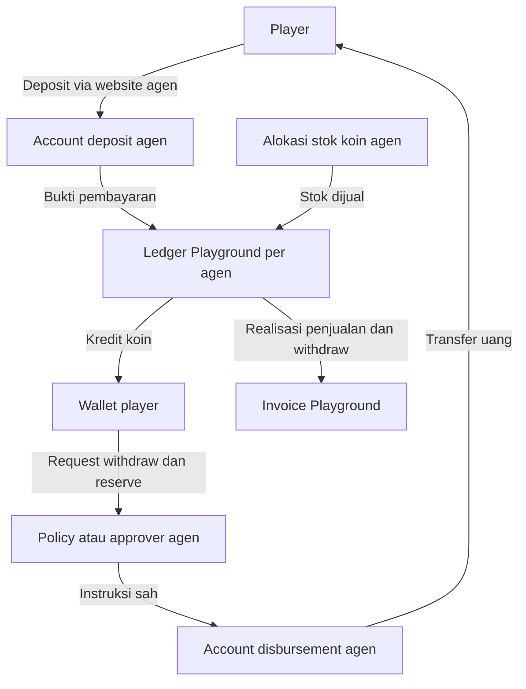

**Playground — Analisis Money Flow V2**

3 November 2026, WIB. Status: rancangan bisnis dan kontrol pencatatan; belum diimplementasikan.

Dokumen ini memperbarui bagian money flow dari riset sebelumnya berdasarkan arahan terbaru: **otoritas operasional deposit dan withdraw berada pada agen**. Playground mengelola koneksi provider, pencatatan yang tidak dapat dimanipulasi, distribusi koin, serta invoice penggunaan. Pemilihan gateway tetap di Playground. Tidak ada transaksi, perubahan saldo, atau perubahan konfigurasi produksi dalam riset ini.

**1. Kesimpulan desain**

Skema dapat dibuat konsisten apabila empat hal dipisahkan: dana uang nyata milik/teralokasi ke agen, stok atau kuota koin yang boleh dijual agen, kewajiban saldo player, dan fee Playground. Agen menetapkan kebijakan approval; sistem menjalankan kebijakan itu setelah validasi transaksi, izin, stok, dan dana.

Penyesuaian terpenting adalah mendefinisikan top-up koin agen sebagai alokasi persediaan/limit penjualan yang ditagih berdasarkan realisasi, apabila pembayaran ke Playground memang baru dilakukan melalui invoice 20% di akhir bulan. Ini adalah interpretasi yang direkomendasikan, belum keputusan bahwa agen wajib membayar nominal penuh saat meminta koin.

Deposit dikurangi withdraw merupakan basis arus kas bersih sesuai kontrak. Angka itu tidak otomatis sama dengan laba atau pendapatan permainan. Kedua basis yang diminta — gross sales dan sales minus player withdrawals — tetap dapat disediakan.

**2. Wewenang yang direvisi**

| Aktivitas | Agen | Playground |
|---|---|---|
| Pilih provider, simpan credential, hubungkan account | Tidak memilih provider; melengkapi data rekening/account sendiri | Integrasi, verifikasi dan pemetaan account |
| Mode deposit/withdraw satu account atau terpisah | Menentukan kebutuhan saat onboarding | Mengonfigurasi mapping yang didukung provider |
| Kebijakan auto-deposit | Mengaktifkan metode yang tersedia sesuai setup | Verifikasi event provider dan membukukan satu kali |
| Manual deposit | Admin agen memeriksa dan menyetujui sesuai izin; supervisor wajib untuk override transaksi auto | Menjalankan validasi bukti, stok, izin, deduplikasi dan audit |
| Ambang auto-withdraw | Owner/finance supervisor agen mengatur | Menyimpan versi policy dan mengeksekusinya |
| Manual withdraw | Approver agen memutuskan | Mengirim instruksi yang telah sah ke provider dan merekonsiliasi |
| Mengisi dana withdraw | Agen menyediakan dana | Memantau top-up yang terkonfirmasi dan saldo tersedia |
| Meminta stok koin | Agen mengajukan | Menyetujui alokasi/limit dan mencatat stok |
| Rate dan basis invoice | Melihat/menerima ketentuan kontrak | Mengatur rate, default 20%, basis dan tanggal berlaku |
| Memperbaiki riwayat | Permintaan koreksi dengan alasan | Journal koreksi terotorisasi; bukan menghapus transaksi asli |

Playground tidak menjadi approver bisnis rutin setiap withdraw. Penolakan teknis karena signature salah, dana tidak cukup, tenant salah, atau transaksi duplikat tetap wajib; itu bukan pengalihan authority agen. Ketentuan provider atau hukum tetap dapat membatasi transaksi.

**3. Pisahkan saldo-saldo ini di dashboard**

| Saldo/pencatatan | Isi | Bukan |
|---|---|---|
| Deposit funds | Dana penerimaan agen, dipisah pending settlement dan available | Penjualan koin yang belum dibayar |
| Withdrawal funds | Dana tersedia untuk disbursement dan outgoing yang masih diproses | Stok koin |
| Agent coin stock | Koin/kuota alokasi, reserved untuk checkout, dan sisa yang boleh dijual | Uang di gateway atau pendapatan Playground |
| Player wallet | Available, reserved untuk ronde/withdraw, dan bonus terpisah | Kas bebas agen |
| Playground fee | Estimasi fee, invoice terbit, credit note, pembayaran dan piutang | Pemotongan dana otomatis yang sudah terjadi |
| Operational reserve | Dana penyangga sesuai kebijakan untuk payout, reversal dan biaya | Tambahan saldo player |

Pada mode shared account, deposit funds dan withdrawal funds merupakan dua tampilan atas rekening saldo yang sama. Jangan menjumlahkan keduanya menjadi dua kali aset. Pada mode split, keduanya dapat benar-benar terpisah. Saldo milik agen A tidak dipakai untuk membiayai agen B tanpa pengaturan bisnis terpisah yang eksplisit.

Contoh ilustratif saja: kurs 1 koin = Rp1, player membayar Rp100.000. Nilai penjualan tercatat Rp100.000, wallet player mendapat 100.000 koin, stok jual agen berkurang 100.000 koin, dan penerimaan gateway dicatat sesuai status pending/available. Fee provider dicatat terpisah. Dashboard admin menampilkan perubahan itu; tidak ada penciptaan wallet spendable kedua senilai Rp100.000 untuk admin.

**4. Topologi uang dan koin**

Pada shared mode, node account deposit dan disbursement menunjuk saldo provider yang sama. Diagram tidak menunjukkan bahwa saldo koin dapat dipindahkan menjadi dana provider tanpa transaksi uang nyata.

**5. Deposit otomatis dan manual**

Untuk QRIS/VA, alur yang disarankan:

1. Website meminta checkout pada tenant yang sudah terverifikasi.
2. Sistem memeriksa stok jual dan mereservasi jumlah koin yang diperlukan sebelum menerbitkan instruksi pembayaran.
3. Provider menerima pembayaran. Callback diterima secara durable dan diverifikasi; detail order, account agen, jumlah, currency dan provider transaction ID harus cocok.
4. Satu transaksi database mengonsumsi reservasi stok, mengkredit wallet player, serta mencatat penjualan dan audit. Event yang sama tidak dapat membukukan kredit lagi.
5. Dashboard agen diperbarui. Status uang di provider tetap dibedakan antara payment confirmed dan dana sudah tersedia untuk disbursement.

Dokumentasi QRIS Xendit, sebagai contoh mekanisme teknis, memisahkan payment processing instan dan settlement T+1 business days. Waktu provider lain dapat berbeda. Artinya, auto-credit wallet setelah konfirmasi pembayaran tidak menjamin uang itu langsung tersedia untuk auto-withdraw. Sumber: [QRIS](https://docs.xendit.co/docs/qris), [settlement overview](https://docs.xendit.co/docs/settlements-overview).

Manual transfer mengikuti jalur: request → pemeriksaan mutasi rekening → approval admin agen yang berwenang → konsumsi stok dan kredit wallet. Untuk nominal besar, bukti tidak jelas, atau risiko tertentu, direkomendasikan eskalasi ke supervisor dengan pengaju dan approver berbeda. Kewajiban supervisor pada override transaksi auto mengikuti arahan pengguna; kewajiban untuk semua transfer manual bukan asumsi default. Screenshot transfer hanya lampiran; bukti penerimaan harus dicocokkan dengan mutasi/referensi bank. Satu mutasi tidak boleh diklaim untuk dua player atau digunakan ulang pada deposit lain.

Tombol manual untuk transaksi auto tetap tersedia sebagai **verifikasi/penyelesaian pengecualian**. Supervisor tidak dapat mengubah callback pending menjadi uang terbayar hanya dengan password. Sistem harus menemukan konfirmasi provider/mutasi yang sah. Bila deposit sudah dikreditkan, tombol tidak boleh mengkredit ulang. Bila perusahaan sengaja memberikan kredit sebelum dana diterima, catat sebagai kredit/adjustment tersendiri, bukan sebagai deposit palsu.

Ada edge case penting: stok checkout habis masa reservasinya tetapi pembayaran datang terlambat, atau VA reusable menerima uang saat stok agen kosong. Dana diterima tetap dicatat. Coba alokasikan stok kembali; bila tidak tersedia, masuk `payment_received_credit_pending`, beri notifikasi/SLA, lalu penuhi atau refund sesuai kebijakan. Jangan menghilangkan event, memberi koin tanpa otorisasi stok, atau menampilkan sukses ketika wallet belum dikreditkan.

**6. Dua mode account gateway**

| Mode | Perilaku | Penyesuaian |
|---|---|---|
| SHARED | Deposit dan payout memakai saldo provider agen yang sama | Dana belum settled belum dapat dianggap saldo payout; monitor available dan outgoing |
| SPLIT | Penerimaan masuk account deposit; withdraw memakai account disbursement lain milik/teralokasi ke agen yang sama | Agen wajib menyediakan dana account disbursement; tidak otomatis mengambil dari deposit account |

Pilihan split membutuhkan dukungan account/subaccount/balance dari provider serta approval onboarding. Pencatatan dua saldo lokal tidak dengan sendirinya menciptakan dua account provider. Dokumentasi [Xendit sub-accounts](https://docs.xendit.co/docs/sub-accounts) dan [Adyen account structure](https://docs.adyen.com/platforms/account-structure-resources) menunjukkan pola pemisahan account/balance, bukan jaminan semua provider mendukung konfigurasi yang sama.

Pada split mode dapat ditawarkan transfer internal deposit → disbursement sebagai fitur opsional yang disetujui agen. Pindah dana tersebut bukan deposit player, bukan penjualan koin, dan bukan pengurang invoice. Top-up dana withdraw dari uang agen juga bukan pembelian koin player.

Perubahan shared/split atau mapping account harus mempunyai tanggal berlaku, audit, dan perlakuan untuk transaksi yang sedang berjalan. Payout lama tetap mereferensikan account asalnya; jangan mengganti account pada retry tanpa rekonsiliasi.

**7. Auto-withdraw dan otorisasi supervisor**

Nilai contoh agen: Rp1.000.000. Karena instruksi menyebut di bawah dan di atas tetapi tidak menentukan sama dengan, rekomendasi batas awal adalah:

| Nilai request | Keputusan jumlah |
|---|---|
| Rp999.999 atau kurang | Kandidat auto-approval |
| Rp1.000.000 atau lebih | Manual approval supervisor agen |

Agen dapat mengubah nominal sesuai hak akses. UI harus menampilkan operator `<` atau `≤` secara jelas. Nilai Rp1.000.000 adalah contoh kebijakan, bukan hardcoded limit provider.

Auto-approval tetap mensyaratkan saldo player yang tersedia, dana disbursement cukup termasuk biaya, rekening tujuan yang valid, pemenuhan verifikasi yang berlaku, serta tidak ada kasus risiko yang memerlukan review. Tambahkan batas kumulatif harian/frekuensi per player dan beneficiary untuk mencegah pecahan request yang menghindari review. Nominal batas harian belum ditentukan.

Urutan: request player → reserve saldo player → evaluasi policy → reserve anggaran payout agen → approval otomatis/manual → kirim instruksi → tunggu bukti provider → finalisasi debit atau pemulihan. Reservasi outgoing harus memperhitungkan dana yang sudah dipotong provider agar tidak dikurangi dua kali.

`Approved` tidak sama dengan `Paid`. Jika dana agen kurang, status `awaiting_agent_funding`; saldo player masih tercatat sebagai reserved, bukan hilang. Sediakan SLA dan jalur batal sebelum provider menerima instruksi. Pembatalan setelah submission bergantung kemampuan provider dan status aktual.

Untuk manual approval, rekomendasi akun pengaju berbeda dari supervisor; supervisor login sendiri dan melakukan autentikasi ulang. Tampilkan player, nominal, biaya dan tujuan. Approval dikaitkan ke transaction ID, versi jumlah/tujuan, challenge sekali pakai dan masa berlaku. Perubahan data membatalkan approval lama. Rujukan: [OWASP Transaction Authorization](https://cheatsheetseries.owasp.org/cheatsheets/Transaction_Authorization_Cheat_Sheet.html).

Metode yang disarankan adalah passkey/WebAuthn dengan user verification; perangkat dapat memakai sidik jari, wajah atau PIN sesuai dukungan. Alternatif operasional adalah password ulang ditambah MFA. Playground tidak menyimpan citra sidik jari. Biometrik untuk persetujuan berbeda dari browser fingerprint untuk analisis risiko. Sumber: [W3C WebAuthn Level 3](https://www.w3.org/TR/webauthn-3/).

**8. Retry, gagal, dan reversal**

| Situasi | Perlakuan |
|---|---|
| Dua approver bersamaan | Hanya satu perubahan state yang berhasil; approval kedua membaca status terbaru |
| API timeout | Lookup memakai business reference yang sama; jangan membuat instruksi baru tanpa kepastian |
| Provider accepted/pending | Pertahankan reserve dan tunggu status; jangan kembali available secara otomatis |
| Failed final, uang tidak terkirim | Lepaskan reserve sesuai bukti dan catat biaya jika tetap dikenakan |
| Succeeded | Finalisasi satu kali berdasarkan definisi terminal provider dan rekonsiliasi |
| Reversed setelah sukses | Tunggu bukti pengembalian dana; catat reversal, pulihkan kewajiban player satu kali, koreksi basis invoice |
| Callback duplikat/tidak urut | Simpan inbox dan aturan state transition; query provider bila bertentangan |

Dokumentasi [Create Payout](https://docs.xendit.co/apidocs/create-payout-v3) menjelaskan idempotency key; [Payout Status Lifecycle](https://docs.xendit.co/docs/payout-status-lifecycle) membedakan accepted, requested, succeeded dan reversed. Implementasi harus memetakan state setiap provider; jangan menganggap satu label sukses lokal sebagai bukti final semua provider.

**9. Top-up koin agen dan sumber koin kemenangan**

Model yang paling selaras dengan tagihan bulanan adalah **alokasi stok jual secara postpaid/konsinyasi**: agen meminta koin, Playground menyetujui kuota, dan hanya realisasi penjualan yang masuk basis invoice. Stok belum terjual dibawa ke bulan berikutnya atau dikembalikan sesuai kontrak, tanpa otomatis menjadi invoice.

| Peristiwa | Stok jual | Penjualan ditagih |
|---|---|---|
| Playground menyetujui alokasi agen | Bertambah | Belum |
| Checkout dibuat | Available berkurang, reserved bertambah | Belum |
| Pembayaran terkonfirmasi dan koin dikreditkan | Reserved dikonsumsi | Ya, sekali |
| Checkout kedaluwarsa tanpa pembayaran | Reserved kembali available | Tidak |
| Refund penjualan yang memenuhi aturan | Koreksi stok bila relevan dan aman | Reversal/credit sesuai kontrak |
| Transfer antarwallet internal | Sesuai aturan transfer | Bukan penjualan baru |
| Top-up dana disbursement agen | Tidak berubah | Tidak |

Jika agen harus membayar di muka, definisikan apakah pembayaran itu deposit jaminan, uang muka fee, atau pembelian koin wholesale. Untuk uang muka fee, pembayaran dikreditkan terhadap invoice; jangan menagih nominal penuh koin lalu menambahkan 20% tanpa model harga terpisah yang disepakati.

Perlu satu keputusan tambahan: **dari mana koin kemenangan berasal?** Rekomendasi memisahkan stok jual dari rekening/pool penyelesaian game dan cadangan risiko agen. Hasil ronde yang valid wajib diselesaikan walau stok jual habis. Jika kapasitas risiko kurang, batasi penerimaan ronde baru sebelum dimainkan; jangan menolak kemenangan sesudah hasilnya keluar.

Untuk versi awal, stok jual diperlakukan sebagai kuota distribusi yang dikonsumsi penjualan baru. Stake, payout kemenangan, dan withdraw tidak otomatis mengisi ulang kuota jual. Jika nanti dipilih model koin beredar yang didaur ulang, pelaporan invoice tetap harus memakai event penjualan, bukan selisih saldo stok. Bonus dan adjustment memiliki bucket/alasan/approval sendiri, agar tidak digunakan untuk menyamarkan penjualan.

Hak/top-up koin tidak menyediakan dana kas untuk membayar player. Agen membutuhkan likuiditas uang nyata dan cadangan exposure permainan terpisah. Kontrak juga harus menentukan siapa yang secara ekonomi menanggung kemenangan besar, jackpot, dan kerugian permainan: agen, Playground, atau provider. Rekening payout milik agen hanya menentukan sumber pembayaran operasional; fee 20% tidak otomatis berarti Playground menanggung 20% kerugian. Credit limit dan jaminan dapat membatasi risiko invoice postpaid, tetapi penghentian penjualan baru karena tunggakan tidak boleh menghapus kewajiban player yang sudah terbentuk.

**10. Dua basis invoice 20% yang diminta**

Rate `r` default 20%; dapat diatur per kontrak agen oleh Playground. Basis belum dipilih sebagai default oleh pengguna, sehingga perlu eksplisit saat kontrak/onboarding.

Definisi usulan:

- `D`: nilai uang penjualan koin player yang pembayarannya sah dan koinnya telah diberikan, setelah koreksi/refund/reversal yang memenuhi ketentuan. Simpan gross sale dan koreksinya sebagai baris terpisah.
- `W`: nominal withdraw player yang benar-benar dibayar, dikurangi reversal yang sudah terbukti. Tidak termasuk penarikan kas oleh pemilik agen, top-up disbursement, transfer internal, atau refund yang sudah mengurangi `D`. Satu pengembalian uang hanya mengurangi basis satu kali.
- Bonus gratis, stok yang belum terjual, volume taruhan berulang, retry, dan pengajuan yang belum selesai tidak termasuk penjualan baru.
- Biaya gateway, payout, pajak dan diskon memiliki field tersendiri. Apakah dikurangkan dari basis harus ditetapkan kontrak, bukan diasumsikan otomatis.
- Kurs/nilai koin disimpan pada transaksi dan versi kontrak. Contoh 1 koin = Rp1 dalam dokumen ini bukan penetapan kurs produksi.

| Mode | Rumus dasar | Arti |
|---|---|---|
| GROSS_COIN_SALES | r × D | Fee atas penjualan koin, termasuk yang masih tersimpan di wallet player |
| NET_SALES_AFTER_WITHDRAWALS | r × (D − W) | Fee atas arus kas penjualan bersih setelah withdraw player, sebelum penyesuaian saldo dan biaya lain |

Perubahan rate/basis berlaku prospektif dengan `effective_from`, versi kontrak, pembulatan dan currency yang jelas. Invoice terbit menyimpan snapshot policy; perubahan dashboard tidak menghitung ulang periode lama diam-diam. Bila rate berubah di tengah periode, perlu segmentasi transaksi dan aturan atribusi withdraw; lebih sederhana berlaku mulai periode baru.

Contoh yang dihitung ulang secara numerik:

| Komponen | Nilai |
|---|---:|
| D: penjualan koin sah | Rp100.000.000 |
| W: withdraw berhasil | Rp60.000.000 |
| Invoice mode gross, 20% | Rp20.000.000 |
| Invoice mode net, sebelum adjustment lain | Rp8.000.000 |

Invoice hanya menghitung fee. Pembayaran invoice adalah aliran uang terpisah agen → Playground. Jangan sekaligus otomatis menarik 20% tiap deposit lalu menagih 20% penuh lagi di akhir bulan. Jika ada pemotongan/uang muka, tampilkan sebagai pembayaran yang mengurangi sisa tagihan.

**11. Mengapa D − W bukan laba permainan**

Deposit dapat masih berada dalam wallet. Withdraw bulan ini dapat berasal dari deposit atau kemenangan bulan sebelumnya. Keduanya membuat arus kas berbeda dari hasil ronde.

Ilustrasi sederhana tanpa bonus, refund, fee, transfer atau adjustment:

`Liabilitas akhir player = liabilitas awal + D − W − hasil bersih permainan untuk agen`

Sehingga:

`Hasil bersih permainan = D − W + liabilitas awal − liabilitas akhir`

Dengan D Rp100 juta, W Rp60 juta, saldo/kewajiban awal player Rp20 juta dan akhir Rp50 juta, hasil permainan adalah Rp10 juta. Fee gross Rp20 juta dan fee net-cash Rp8 juta mempunyai dampak ekonomi sangat berbeda. Itu tidak berarti salah secara kontrak, tetapi tidak boleh disebut bagi hasil 20% laba.

Jika tujuan sebenarnya bagi hasil performa permainan, dapat ditambahkan opsi terpisah berbasis stake dikurangi payout ronde yang valid, dengan aturan bonus/void yang jelas. Perbandingan definisi: [UK Gambling Commission GGY guidance](https://www.gamblingcommission.gov.uk/guidance/regulatory-returns-guidance/rr-guidance-how-to-calculate-your-gross-gambling-yield-ggy) memakai komponen stakes/pendapatan terkait dikurangi prizes/winnings, bukan deposit dikurangi withdraw. Ini rujukan definisi, bukan penetapan yurisdiksi atau rumus pelaporan pajak Playground.

Penghitungan hasil permainan sebaiknya langsung dari ledger ronde lengkap. Persamaan saldo di atas dipakai sebagai rekonsiliasi dan hanya benar dengan semua adjustment yang relevan diperhitungkan. Saldo awal/akhir mencakup reserved dan pending withdrawal yang masih merupakan kewajiban; jangan menghitungnya dua kali.

**12. Angka negatif dan perpindahan bulan**

Mode net wajib mempunyai aturan negatif. Contoh: November menerima Rp40 juta tanpa withdraw, lalu Desember seluruh Rp40 juta ditarik dan tidak ada penjualan baru. Perhitungan November memberi fee Rp8 juta. Jika Desember dipaksa nol tanpa carry/credit, fee tetap Rp8 juta meskipun cumulative D − W menjadi nol.

Usulan: simpan basis negatif dan sediakan credit note/true-up, atau negative carryover dengan aturan penyelesaian ketika agen berhenti. Carryover saja menunda kompensasi ke masa depan; jika agen tidak bertransaksi lagi, tidak otomatis mengembalikan fee yang sudah ditagih.

Untuk ilustrasi rate tetap, satu basis dan tanggal awal kontrak yang jelas, metode true-up kumulatif dapat berupa:

`Target fee kumulatif = r × max(0, cumulative D − cumulative W)`

`Invoice/credit periode = target fee kumulatif − fee neto yang sudah diinvoiskan`

| Periode | Basis periode | Basis kumulatif | Invoice/credit |
|---|---:|---:|---:|
| November | Rp40.000.000 | Rp40.000.000 | Invoice Rp8.000.000 |
| Desember | −Rp40.000.000 | Rp0 | Credit note Rp8.000.000 |

Ini pilihan kontrak yang disarankan, bukan keputusan otomatis bahwa Playground wajib membayar cash refund setiap bulan negatif. Credit note dapat mengurangi invoice belum dibayar atau menjadi kredit sesuai kontrak. Jika hasil neto sejak awal negatif dan tidak ada fee terdahulu, hasilnya nol fee, bukan subsidi tanpa batas ke agen.

Menerapkan ini pada data migrasi memerlukan aturan untuk saldo player sebelum tanggal awal kontrak, supaya withdrawal dari saldo lama tidak mengurangi fee periode baru tanpa kesepakatan. Rate berubah, kontrak berakhir, refund terlambat dan invoice disputed memerlukan segmentasi/penyelesaian yang eksplisit.

**13. Tutup buku dan cadangan kas**

Tutup buku memakai zona waktu Asia/Jakarta dan event ledger yang dapat ditelusuri. Pisahkan waktu kejadian, penerimaan webhook, posting dan periode akuntansi. Alur: closing sementara → rekonsiliasi → daftar pengecualian → review agen → finalisasi statement dan invoice → pembayaran. Due date, masa dispute dan materiality belum ditetapkan.

Statement minimal memuat penjualan auto/manual, refund/reversal, withdraw paid/pending, stok awal/alokasi/terjual/akhir, saldo awal/akhir player, gateway pending/available, biaya, rate/basis, carryover/credit, invoice dan pembayaran. Transaksi setelah periode terkunci masuk adjustment yang merujuk periode asal.

Jangan membayar fee/menarik keuntungan hanya karena saldo gateway positif. Periksa kecukupan kas terhadap kewajiban player, payout berjalan, fee/biaya terutang dan reserve. Hindari penghitungan ganda pending withdrawal yang sudah masuk liabilitas player. Untuk likuiditas segera, hanya available funds yang dapat dipakai; receivable/pending settlement bukan kas siap kirim.

Rekomendasi versi awal mengikuti tagihan bulanan pengguna: accrual fee ditampilkan, tanpa auto-debit komisi. Security deposit, pembatasan stok karena overdue, atau pencadangan fee baru diterapkan bila menjadi ketentuan kontrak yang jelas.

**14. Bagian engine yang perlu ditambahkan**

Baseline yang telah diaudit pada riset sebelumnya adalah CP16, demo wallet source UNO staging. Sesi ini tidak melakukan audit commit terbaru lagi dan tidak menganggap module payment sudah ada.

| Modul | Tambahan |
|---|---|
| Agency policy | Deposit/withdraw authority, auto mode, threshold, daily limits, supervisor roles, policy version |
| Provider account mapping | Tenant, account deposit, account disbursement, shared/split, status verifikasi dan availability |
| Coin allocation | Request, approval, credit limit, available/reserved stock, sales, reversal dan reason code |
| Cashier | Payment intent, manual bank evidence, verified callback inbox, funds received versus coin fulfilled |
| Wallet/ledger | Posting berpasangan yang seimbang per unit/currency, reserve, payout clearing, bonus/payout source terpisah, adjustment tanpa menghapus histori |
| Authorization | Maker/checker, step-up password/MFA atau passkey, transaction-bound approval |
| Payout worker | Durable outbox, idempotency, lookup, retry policy, insufficient-funds queue, reconciliation |
| Billing | Rate 20% default, dua basis, monthly statement, negative basis, credit note, period locking |
| Monitoring | Stok rendah, dana WD rendah, callback gagal, manual approval lama, provider mismatch, fee overdue |

MVP diuji pada dua agen sintetis: deposit auto/manual, race callback dan approval, shared/split, stok kosong, pembayaran terlambat, threshold Rp999.999/Rp1.000.000, pemecahan withdraw, dua payout bersamaan, timeout, reversal, dan invoice lintas bulan. Setiap skenario harus membuktikan tidak ada kredit, pemotongan, invoice atau payout ganda.

**15. Keputusan yang perlu ditetapkan sebelum implementasi produksi**

| Keputusan | Rekomendasi awal |
|---|---|
| Top-up koin agen | Alokasi postpaid dengan limit; prepaid hanya jika uang muka dikreditkan secara jelas |
| Rate | 20% default sesuai arahan, editable oleh Playground berdasarkan kontrak |
| Basis | Dua mode tersedia; pilih eksplisit per kontrak |
| Sama dengan threshold | Manual pada ≥ Rp1.000.000 untuk contoh awal |
| Negatif pada mode net | True-up/credit note atau carryover dengan final settlement saat agen keluar |
| Koin kemenangan | Pool settlement/cadangan risiko terpisah dari stok jual; hasil sah tetap dipenuhi |
| Stok setelah withdraw | Tidak otomatis memulihkan kuota jual pada model awal |
| Biaya provider/pajak | Baris terpisah; siapa menanggung dan apakah deductible ditetapkan kontrak |
| SLA pending dana/stok | Harus ditentukan; player mendapat status akurat dan jalur penyelesaian |
| Keuntungan agen dan dana player | Kewajiban player dan reserve diperhitungkan sebelum dana bebas ditarik |

Kemampuan API dan kelayakan model usaha adalah dua hal berbeda. Dokumentasi Xendit/Adyen di sini dipakai untuk mempelajari mekanisme account, settlement dan payout, bukan rekomendasi provider. Xendit secara eksplisit menyebut online gambling tidak dilayani dalam [kebijakan bisnisnya](https://help.xendit.co/hc/en-us/articles/360035083951-Are-there-any-businesses-that-Xendit-prohibits). Model koin yang dapat ditukar uang, wilayah operasi dan persetujuan provider perlu dinilai sesuai aktivitas sebenarnya sebelum aktivasi QRIS/VA/disbursement. Aturan pengakuan pendapatan dan pajak final perlu dipastikan terpisah dari rumus invoice komersial.

Seluruh contoh hitung menggunakan angka ilustratif dan sudah diperiksa dengan aritmetika desimal. Tidak ada fee, saldo, account atau payment provider yang diaktifkan oleh dokumen ini.
